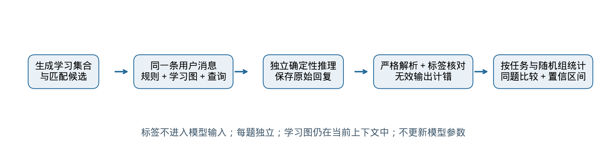
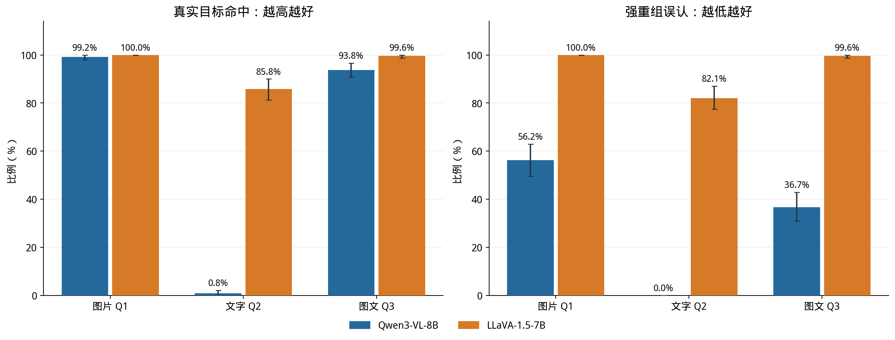
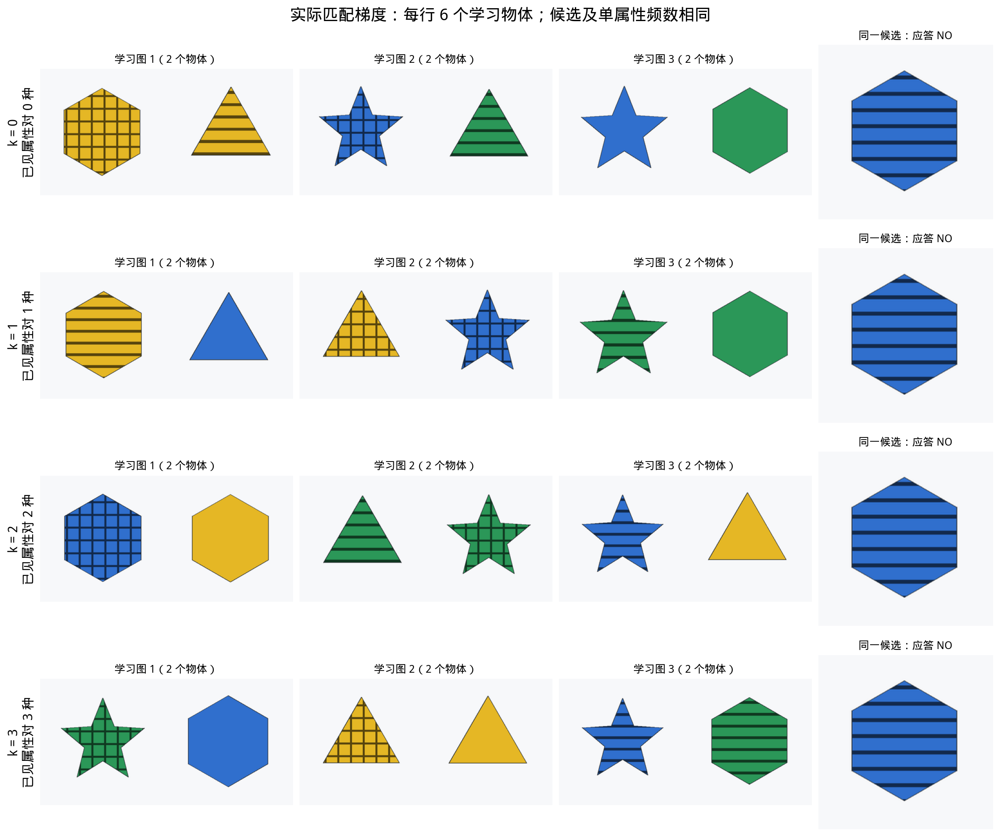

# BindMem：视觉语言模型物体属性绑定评测

**完整项目报告 · Qwen3-VL-8B 与 LLaVA-1.5-7B · 2026-10-29**

数据版本：BindMem v2 与六物体匹配重组梯度。本文汇总已完成的行为实验，不包含探针或内部机制实验。所有主要结论使用正式 test；开发集初步结果不混入正式成绩。

## 摘要

本项目检验视觉语言模型能否区分“见过一些属性”与“见过由这些属性共同构成的完整物体”。程序生成颜色、纹理、形状可控的物体，要求模型在同一上下文中的学习图片之后回答识别、选择、属性回忆和关系问题；进一步构造单属性与两两属性统计相同的严格正负世界，以及固定单属性频数、只按候选已见属性对数量分级的重组梯度。

Qwen3-VL-8B 完成原基准全部 93,120 题，其中正式 test 69,840 题；另完成六物体梯度 7,680 题，其中 test 5,760 题。LLaVA-1.5-7B 完成精简的 5,520 道正式 test，与 Qwen 逐题配对比较。Qwen 在单物体属性识别、基础图片判断和简单左右／上下关系上接近满分，但严格图片判断中能认出 99.17% 的目标，却误认 56.25% 的强重组负例。新增梯度中，Qwen 图片查询的负例误认率随已见属性对数量 0→1→2→3，依次为 0.00%、0.83%、10.42%、39.17%。

LLaVA 在严格图片判断和图片梯度中全部回答 YES，因而目标命中率和负例误认率同时为 100%，平衡题集准确率为 50%。这反映当前多图协议下的接受偏向，不能称为随机猜测，也不足以单独证明其绑定机制弱于 Qwen：LLaVA 的严格二维三属性识别仅为 67.08%，存在基础识别及格式问题；模型的原生分辨率、提示包装和多图训练经历也不同。总体而言，单一准确率会掩盖不同的失败模式，需同时报告目标命中、负例拒绝、误认和原始回复。

## 1. 研究问题与项目范围

物体身份定义为三元组 `(颜色, 纹理, 形状)`。例如见过“红色、纯色、星形”和“红色、条纹、正方形”，并不等于见过“红色、纯色、正方形”。如果模型把不同物体的属性组合成一个从未出现的物体，就会产生重组误认。研究的目的不是单纯提高任务分数，而是辨别这种误认与视觉识别、回答偏向、查询形式及场景难度之间的关系。

| 研究问题 | 实验对应 | 需要观察的证据 |
| --- | --- | --- |
| 看清单个特征后，是否仍然绑定错误？ | L0 校准＋L1/L2 | 识别准确率、目标命中、不同诱饵的误认 |
| 单个属性和属性对都熟悉时，还能认出完整三元组吗？ | L2 严格反事实 | 同一查询在正负世界的单题及成对正确率 |
| 问法、数量、布局和空间／三维因素如何影响表现？ | Q1–Q8、L3–L5 | 分条件成绩与有效的配对差 |
| 重组难度是否有梯度，另一模型是否复现？ | G 梯度＋双模型同题比较 | 各 k 的误认曲线、命中曲线和原始案例 |

本项目是上下文内的视觉行为评测：每题生成时学习图仍在输入中，模型权重不更新。它不测试跨会话长期记忆，也没有把中间隐藏状态、探针结果或神经机制作为证据。当前范围不包含独立的上下文距离或额外视觉干扰图研究。旧版 `PROJECT_REPORT.md` 的历史数据不与 v2 混合。

## 2. 数据集与已完成实验

| 属性 | 取值 | 数量 |
| --- | --- | --- |
| 颜色 | 红、黄、蓝、绿、紫、橙 | 6 |
| 纹理 | 纯色、条纹、圆点、网格 | 4 |
| 形状 | 圆形、三角形、正方形、星形、五边形、六边形 | 6 |

共有 144 种完整属性组合。二维物体由 Pillow 绘制，三维物体使用挤出轮廓、纹理和深度遮挡的程序化渲染。所有图片都是受控合成材料，不是自然照片。学习图和查询图采用确定性但不同的渲染参数，身份一致不要求像素相同；布局变化可能同时改变图片数量和视觉输入规模。

| v2 任务 | dev 题数 | test 题数 | 完成范围 |
| --- | --- | --- | --- |
| L0 单物体属性识别 | 320 | 960 | Qwen 全部完成 |
| L1 基础绑定与普通诱饵 | 8,880 | 26,640 | Qwen 全部完成 |
| L2 严格三元组绑定 | 1,120 | 3,360 | Qwen 全部完成 |
| L3 数量与每图布局 | 7,840 | 23,520 | Qwen 全部完成 |
| L4 空间与共同出现关系 | 640 | 1,920 | Qwen 全部完成 |
| L5 三维、视角与遮挡 | 4,480 | 13,440 | Qwen 全部完成 |

| 补充实验 | Qwen 正式 test | LLaVA 正式 test | 比较原则 |
| --- | --- | --- | --- |
| 二维校准＋L2 的 Q1/Q2/Q3 | 1,680（来自原基准） | 1,680 | 完全相同 trial_id |
| 六物体 0–3 梯度 Q1/Q3 | 3,840 | 3,840 | 完全相同 trial_id |
| 六物体梯度 Q2 | 1,920 | 未运行 | 仅报告 Qwen，不能声称双模型复现 |

原基准与梯度各有 320 个随机组，按整组分为 80 个 dev 和 240 个 test。两套数据使用不同生成种子，是不同实验中的组；同组的世界、查询形式和条件不跨 dev/test。Qwen 共完成 75,600 道正式 test（69,840＋5,760），但不会把不同题型混成一个总准确率。LLaVA 正式同题比较只覆盖上表的 5,520 题，不代表它已完成全部 v2。四物体 1–3 梯度代码已实现，但本报告没有该设计的正式运行结果。

原基准生成种子为 20261022，梯度为 20261028，推理固定种子为 20261022。Qwen 原基准正式 test 有 436 条无效回答（0.62%），均按错误计分；这不属于缺失题或程序失败。LLaVA 正式范围的无效回答为 28 条，全部来自二维校准，其余二元判断均能按规则解析。

LLaVA 最初启动过全量任务，观察到选择题频繁产生不符合格式的长篇描述后，为加快获得核心结果而停止全量作业。后续范围只按任务类型选择，保留完整的 240 个 test 组，没有按某道题答对与否筛选。核心结果复用 85 条已完成的同题回复，并补齐剩余题目；原始全量阶段记录保留，未完成任务不报告正式完整成绩。这是观察结果后的范围调整，应如实披露。

## 3. 输入、输出与评分协议



*图 1｜从题目生成到同题统计的完整流程。标签只在评分阶段使用。*

应用层为每题创建一条独立的用户多模态消息，依次放入规则、带序号的学习图片、学习结束文字、查询内容。前一题的模型回答不会带入后一题。Qwen 使用原生聊天模板；LLaVA 使用 USER/ASSISTANT 包装并保留图文交错顺序。

共同规则的实际英文原文：

```text
Remember the study objects. Identity requires the SAME color, texture AND shape on one object. Position, size and viewpoint do not change identity. Shapes of 3D objects refer to their front silhouettes. 
```

结构示例：

```text
USER
  [任务规则]
  Study image 1: [学习图片 1]
  Study image 2: [学习图片 2]
  ...
  End of study. Answer the following query.
  [查询文字和／或查询图片]
ASSISTANT
  [模型生成的回答]
```

| 问法 | 查询输入 | 规定输出 |
| --- | --- | --- |
| CAL 校准 | 单张学习图后要求识别颜色、纹理、形状 | 恰好含三个指定字段的 JSON |
| Q1 图片判断 | 候选图片＋是否完整出现的问题 | YES / NO |
| Q2 文字判断 | 候选的三属性文字描述，无候选图；学习仍是图片 | YES / NO |
| Q3 图文判断 | 候选图片＋三属性文字描述 | YES / NO |
| Q4 同图二选一 | 一张包含 A、B 候选的图片 | A / B |
| Q5 分图二选一 | A、B 各自一张候选图片 | A / B |
| Q6 四选一 | 一张包含 A–D 候选的图片 | A / B / C / D |
| Q7 纹理回忆 | 给颜色和形状，询问该物体的纹理 | SOLID / STRIPES / DOTS / GRID |
| Q8 关系判断 | 描述两个物体及待判断的空间／共现关系 | YES / NO |

例如 Q1 的真实查询文字为：

```text
Did this complete object occur in the study set? Output only YES or NO.
```

Q2 在此前加上候选属性句，例如 `The candidate is a red solid square.`；Q3 同时提供候选图和同样的属性句。标准答案、题目 ID、私有物体属性列表和“强重组”等类型标签不会额外输入模型。报告中的中文解释只供读者阅读。

评分先去除首尾空白，对非 JSON 回答统一大小写；因此 `Yes` 可以解析为 YES，但 `YES because ...`、`A.`、越界选项或不合要求的 JSON 均计为无效，并按错误计入准确率。校准要求颜色、纹理、形状三个字段同时符合词表且全部正确。没有在看到模型结果后放宽解析规则，也没有把解释性长回复事后猜测成选项。

| 指标 | 分母与含义 | 阅读要点 |
| --- | --- | --- |
| 准确率 | 对应题目中严格判定正确的比例 | 无效输出计错，不跨题型混合 |
| 目标命中率 | 真实目标中正确回答 YES 的比例 | 应与负例表现同时看 |
| 负例误认率 | 完整候选未出现时，错误回答 YES 的比例 | 越低越好；不包括无效回答 |
| 负例正确拒绝率 | 完整候选未出现时，正确回答 NO 的比例 | 越高越好；有无效输出时不等于 1 减误认率 |
| 成对正确率 | 同一对应正负世界的两道题均答对的比例 | 可识别恒定回答造成的虚高单题成绩 |
| 同题模型差 | LLaVA 正确率减 Qwen 正确率 | 按完全相同 trial_id 配对，单位为百分点 |

主要置信区间使用 1,000 次按 cluster_id 的 bootstrap，保留同组内问法、世界和条件的关联；模型差和梯度差使用配对统计。独立统计单位是 240 个随机组，而不是把所有相关题目当作独立样本。全对或全错时经验区间可能退化为一个点，不表示总体没有不确定性。区间未作多重比较校正，边界差异不解释为普遍规律。已有汇总与同题子集重新汇总的 bootstrap 组遍历顺序可能不同，区间端点存在小幅 Monte Carlo 差异；各图和对应导出表使用同一份统计对象。

## 4. 模型、运行设置与比较边界

| 设置 | Qwen3-VL-8B-Instruct | LLaVA-1.5-7B |
| --- | --- | --- |
| 权重 | 本地 Qwen3-VL-8B-Instruct | llava-hf/llava-1.5-7b-hf；固定 commit |
| 生成 | do_sample=False；最多 80 个新 token | 相同 |
| 数值与注意力 | dtype=auto；SDPA | FP16；SDPA |
| 图片处理 | 原生动态分辨率，max_pixels=802816 | 先按 CLIP 均值补方，再原生缩放至 336×336 |
| 多图顺序 | 规则、学习图、结束提示、查询 | 语义顺序一致，使用 LLaVA 的文本包装 |
| 硬件 | 单张 NVIDIA RTX 3090 | 单张 NVIDIA RTX 3090 |
| 依赖 | torch 2.10.0+cu128；transformers 5.19.0 | 相同推理环境 |
| 可比范围 | 原 v2 全套＋梯度 Q1/Q2/Q3 | 二维校准、严格 Q1/Q2/Q3、梯度 Q1/Q3 |

LLaVA 权重 commit 为 `b234b804b114d9e37bb655e11cbbb5f5e971b7a9`。它的原生上下文为 4,096 token；预检发现原全量基准中 4,480 道 dev＋test 的“8 个学习物体、每图 1 个”题超限，故不会通过截断原题来凑完整结果。本次精简的 5,520 道 test 均在支持范围内，没有上下文排除题。补方步骤用于防止中心裁剪切掉宽图上的物体，但有效物体分辨率与 Qwen 不同。

LLaVA 官方文档指出，多图输入技术上可行，但该模型没有专门针对同一提示中的多图进行训练。因此这里比较的是两个模型各自完整推理系统在同一受控题目上的表现，不能把差距全部归因于“记忆容量”或“绑定机制”。[LLaVA 模型卡](https://huggingface.co/llava-hf/llava-1.5-7b-hf)、[Transformers LLaVA 文档](https://huggingface.co/docs/transformers/model_doc/llava)。

## 5. Qwen 全套实验：目的、设计与结果

这一部分涵盖 Qwen 已完成的全部原基准。各实验的题目可能从不同查询维度重复使用相同随机组，不能把下面每个实验标题理解为互不重叠的数据集。尤其“查询方式”是跨 L1/L2/L3/L5 的分析维度。


*图 2｜真实严格正负世界。上下两题的查询物体相同；单属性与两两属性出现次数匹配，完整三元组是否出现不同。*

### 实验 1：先确认模型看得清属性

**实验目的：** 检查颜色、纹理和形状识别是否存在明显基础问题，为解释绑定错误提供参照。

**怎么做：** 每次只给一个物体，要求同时输出颜色、纹理和形状；覆盖二维、固定视角三维、另一三维视角和遮挡三维。

**正式测试规模：** 共 960 题，每种呈现 240 题。


*图 3｜三个属性同时答对才记为正确。纵轴从 0 开始，顶部数值展示接近满分的细小差异。*

**结果：** 联合属性识别为 **99.90%**；前三种呈现均为 100%，遮挡为 99.58%。遮挡条件下有一条回答不符合允许的属性词表，严格评分记为错误。

**说明：** 简单单物体属性识别整体可靠，但这并不保证多物体学习后的查询同样容易，也不能排除后续任务中的视觉识别问题。

### 实验 2：基础绑定与不同诱饵

**实验目的：** 检验模型是否把“属性分别见过”误当成“完整物体见过”，并区分拒绝所有候选与真正识别。

**怎么做：** 每组学习 2、3 或 4 个物体，每张图放一个。判断题比较四类没见过的候选：所有属性全新、仅一类属性见过、仅两类属性见过、三类属性都见过但组合新。每类负例都配有真实出现过的正例。

**正式测试规模：** 图片、文字、图文三种判断各 5,760 题；其中目标 2,880 题，每类诱饵 720 题。另有二选一、四选一与属性回忆，见实验 4。


*图 4｜左：诱饵错误接受率，越低越好；右：真实目标命中率，越高越好。两图纵轴范围不同，不能直接比较柱子的视觉高度。*

**结果：** 图片判断对全新物体和只熟悉一类属性的诱饵均无误认，但对属性重组诱饵的误认率为 **4.44%**。文字判断对所有诱饵的误认率都是 0%，同时却只认出 **6.63%** 的真实目标。

**说明：** 低误认率必须结合目标命中率解释。文字查询在本任务下主要呈现“很少回答见过”的倾向，不能据此判断绑定能力更强。

### 实验 3：严格配对，检验完整三元组合

**实验目的：** 减少单个特征或两两特征熟悉程度的作用，要求模型区分完整颜色—纹理—形状组合。

**怎么做：** 构造两组各 4 个物体的学习集合：单个属性及所有属性对的出现次数一致，同一个查询物体只在其中一组出现。两题的查询图片/文字相同，正确答案一正一负。本章图 2 展示一组真实例子。

**正式测试规模：** 每种问法 480 题，来自 240 对；图片、文字、图文判断各有目标 240 题、严格重组诱饵 240 题。


*图 5｜同一实验的三种读法。左：单题准确率，虚线为均衡判断题的 50% 参照；中：目标命中与诱饵误认；右：同一对正负题都正确的比例。*

**结果：** 图片判断准确率为 **71.46%**，能认出 240 个真实目标中的 238 个，却将 **56.25%** 的严格诱饵误认成见过；正负两题同时答对的比例只有 **43.33%**。文字判断仅认出 240 个目标中的 2 个，负例全部答对，得到 **50.42%** 的总准确率。

**说明：** “约 50%”不意味着随机猜测；这里文字回答几乎总是拒绝。图片判断则更愿意接受候选，却对复杂重组有明显误认。

### 实验 4：同样的学习材料，换一种问法

**实验目的：** 检查输入信息、候选布局和回答形式对表现的影响，避免只用一个提问模板代表模型能力。

**怎么做：** 比较图片/文字/图文判断、同图/分图二选一、四选一和属性回忆。图片、文字、图文判断按相同查询语义配对；同图与分图二选一保持候选身份、顺序和学习内容一致。四选一、回忆属于补充任务，不与判断题混合计算总分。

**正式测试规模：** 严格绑定各问法 480 题，多物体绑定各 3,360 题，三维扩展各 1,920 题。基础绑定的三种判断各 5,760 题，三种选择各 2,880 题，回忆 720 题。


*图 6｜上：各任务准确率总览，热图只展示数值，不能忽略不同任务的线索和猜测概率。下：真正可配对的问法差异及 95% 区间；标注单位为百分点。*

**结果：** 在严格绑定中，图文判断相对图片判断提高 **+7.08 个百分点（95% 区间 +4.17 至 +10.00）**；但基础绑定下降，多物体绑定的差值区间跨过 0。分图二选一在严格绑定中提高 **+5.00 个百分点（95% 区间 +1.04 至 +8.96）**，多物体绑定提高 **+4.17 个百分点（95% 区间 +2.20 至 +6.13）**；三维汇总差异不明确。

**说明：** 没有一种问法在所有实验里都最好。严格任务中的四选一额外加入了两个在两组学习集合中均未出现的候选，四个候选并非同等熟悉。属性回忆先给颜色和形状，再问纹理，线索与输出空间都不同。因此，回忆分数高不能直接解释为“比判断更强的同一种记忆”。

### 实验 5：分开研究总数量与每图数量

**实验目的：** 检验总物体数和每图摆放数量各自对应什么变化，而非预设“越多越差”。

**怎么做：** 严格配对任务保持查询核心不变；总数为 8 时，在原有 4 个核心物体外加入 4 个两种世界共用的物体。总数 4 比较每图 1/2/4 个；总数 8 比较每图 1/2/4/8 个。固定总数比较布局，固定每图数量比较总数。

**正式测试规模：** 7 个数量条件，每条件、每问法 480 题；每种问法合计 3,360 题。


*图 7｜上排固定总数，观察每图数量变化；纵轴为 40%–95% 以便比较。下排固定每图数量，直接比较总数 8 减总数 4 的配对差异。*

**结果：** 图片判断在总数为 8 时，每图 1/2/4/8 个的准确率为 **76.25% / 81.88% / 79.17% / 73.13%**，并不单调。每图 4 个时，将总数从 4 增至 8，图片判断反而增加 +8.12 个百分点（95% 区间 +3.75 至 +12.50）。

**说明：** 本数据不支持简单的“数量越多，准确率越低”。布局变化还会改变图片数和视觉输入规模；这些因素没有完全分离，不能将差异解释成独立的记忆容量效应。

### 实验 6：物体不变，关系改变

**实验目的：** 检查模型能否利用物体之间的相对位置、深度和共同出现信息。

**怎么做：** 每对题保持物体身份相同，通过交换位置或调整分组，使同一个关系问题的正确答案发生变化。左右、上下、深度前后使用 2 个物体；共现使用 4 个物体、每图 2 个，改变哪两个共同出现。

**正式测试规模：** 每类关系 480 题、240 对；共 1,920 题。


*图 8｜四种关系判断的准确率及 95% 区间。虚线为均衡 Yes/No 的 50% 参照；不同关系的视觉材料和物体数量并不完全一致。*

**结果：** 左右和上下均为 **100%**，深度前后为 **79.38%**，同图共现为 **78.96%**。

**说明：** 模型在这些简单左右/上下场景中表现可靠，但复杂关系并未同样达到满分。由于深度使用三维材料、共现使用更多物体，不能将四类分数差全部归因于抽象“关系类型”。

### 实验 7：三维、跨视角和查询图遮挡

**实验目的：** 检查二维结果能否延伸到受控三维物体，以及改变查询图的视角或可见性如何影响回答。

**怎么做：** 保持同组物体的属性语义和严格配对设计，比较二维、固定视角三维、跨视角三维、查询图部分遮挡。三维物体由二维轮廓挤出成网格并做深度遮挡渲染；跨视角/遮挡操作施加在查询图上。

**正式测试规模：** 每种模式、每种问法 480 题；4 种模式 × 7 种问法，共 13,440 题。


*图 9｜上左：图片与图文判断随模式变化，纵轴为 40%–90%；上右：以固定视角三维为基准的配对差异。下：所有问法分模式结果；Q2/Q7 的三种三维条件没有查询图变化，不是独立视觉实验。*

**结果：** 图片判断由固定视角三维的 **66.88%** 降至查询遮挡的 **50.00%**，差值为 -16.88 个百分点（95% 区间 -19.79 至 -13.96）。图文判断对应从 **74.79%** 降至 **50.00%**。跨视角本身没有呈现预设的稳定下降：图片判断略升，图文判断差值区间跨过 0。

**说明：** 遮挡可能降低查询物体本身的可识别性，所以下降不能直接等同于忘记学习内容。文字判断与属性回忆没有查询图片，其三维模式下重复输入的结果不能被当成额外独立证据。

### 全部问法的 Qwen 成绩总表

| 问法 | L1 基础绑定 | L2 严格绑定 | L3 多物体 | L5 三维扩展 |
| --- | --- | --- | --- | --- |
| 图片判断 | 99.25% | 71.46% | 76.13% | 64.69% |
| 文字判断 | 53.32% | 50.42% | 56.34% | 51.82% |
| 图文判断 | 96.55% | 78.54% | 76.70% | 69.69% |
| 同图二选一 | 97.33% | 70.63% | 74.52% | 66.98% |
| 分图二选一 | 99.41% | 75.63% | 78.69% | 67.55% |
| 四选一 | 93.82% | 70.63% | 69.94% | 70.63% |
| 纹理回忆 | 100.00% | 90.83% | 87.14% | 91.30% |

L2 每格 480 题，L3 每格 3,360 题，L5 每格 1,920 题。L1 的 Q1–Q3 各 5,760 题，Q4–Q6 各 2,880 题，Q7 为 720 题。基础绑定中的普通重组只保证候选属性分别熟悉，不等同于所有候选属性对均出现过的强重组；不能用普通负例的高拒绝率替代严格任务表现。完整分条件正确数、分母和区间见附表与 CSV。

## 6. 两个模型的正式同题比较

比较使用相同的 240 道二维校准题，以及相同的严格绑定 Q1/Q2/Q3 各 480 题，合计 1,680 题。没有将 LLaVA 精简集与 Qwen 全套汇总直接对比。


*图 10｜正式同题准确率。左侧为三属性联合识别；右侧为严格绑定判断。误差线为按组 95% 区间。*

| 任务 | 题数 | Qwen 准确率 [95% CI] | LLaVA 准确率 [95% CI] |
| --- | --- | --- | --- |
| 二维校准 | 240 | 100.00%（240/240） [100.00, 100.00] | 67.08%（161/240） [60.83, 72.92] |
| 图片判断 | 480 | 71.46%（343/480） [68.33, 74.58] | 50.00%（240/480） [50.00, 50.00] |
| 文字判断 | 480 | 50.42%（242/480） [50.00, 51.04] | 51.88%（249/480） [49.16, 54.58] |
| 图文判断 | 480 | 78.54%（377/480） [75.42, 81.46] | 50.00%（240/480） [50.00, 50.00] |

LLaVA 二维联合识别为 161/240（67.08%）。其中 28 条输出无效，另有 51 条格式有效但至少一个属性错误；仅在有效回答中计算也只有 161/212（75.94%），这一诊断值不替代主评分。Qwen 同一批二维校准题为 240/240。因而双模型差距从单物体识别和输出遵循阶段就已存在，不能直接把后续差距解释为纯粹的绑定差。



*图 11｜把目标命中和强重组误认拆开。蓝色为 Qwen，橙色为 LLaVA；左图越高越好，右图越低越好。*

| 问法 | Qwen 目标命中 | Qwen 强重组正确拒绝 | LLaVA 目标命中 | LLaVA 强重组正确拒绝 |
| --- | --- | --- | --- | --- |
| 图片判断 | 99.17%（238/240） [97.92, 100.00] | 43.75%（105/240） [37.08, 50.42] | 100.00%（240/240） [100.00, 100.00] | 0.00%（0/240） [0.00, 0.00] |
| 文字判断 | 0.83%（2/240） [0.00, 2.08] | 100.00%（240/240） [100.00, 100.00] | 85.83%（206/240） [81.25, 90.00] | 17.92%（43/240） [12.92, 22.50] |
| 图文判断 | 93.75%（225/240） [90.83, 96.67] | 63.33%（152/240） [57.08, 69.17] | 99.58%（239/240） [98.75, 100.00] | 0.42%（1/240） [0.00, 1.25] |

图片判断中，LLaVA 对 480 题全部回答 YES：240 个目标全对、240 个强重组负例全错，因此准确率恰好 50%。图文判断则几乎全答 YES，目标命中与误认均为 239/240，准确率也为 50%。文字判断表现为较强的接受倾向；相对地，Qwen 文字判断几乎全部拒绝，只有 2/240 个目标被命中。相似的约 50% 准确率背后，是方向相反的回答偏向。

| 任务 | LLaVA 减 Qwen（百分点） | 配对差的 95% 区间 |
| --- | --- | --- |
| CAL | -32.92 | [-39.17, -27.08] |
| Q1 | -21.46 | [-24.58, -18.33] |
| Q2 | +1.46 | [-1.25, +4.17] |
| Q3 | -28.54 | [-31.46, -25.42] |

图片与图文判断的差异区间均在 0 以下，说明在当前同题协议中 Qwen 的严格正确率较高；文字判断差异区间跨 0，不能把 LLaVA 数值上略高解释为清晰优势。二元准确率接近 50% 不自动等价于随机猜测；应优先结合命中、误认和真实回复解释。

## 7. 严格匹配的重组难度梯度

### 7.1 目的与组合约束

原 L2 只检验最强的三属性对重组，本实验进一步问：在单属性熟悉度相同时，候选的已见属性对从 0 增加至 3，误认是否随之改变？这里 k 表示已见属性对的“种类数”，三个可能的属性对是颜色—纹理、颜色—形状、纹理—形状。负例的完整三元组始终没有出现。

最初设想固定 4 个学习物体并保持候选属性频数相同，但无法同时实现 k=0 与 k=3：在三元组未出现的前提下，覆盖三种属性对要求每种候选属性至少出现两次，共至少 6 次；而 k=0 时每个物体最多包含一种候选属性，4 个物体最多容纳 4 次。因此完整梯度改为固定 6 个学习物体。这是明确的组合约束，并非事后挑选难度。

| 控制项 | 正式六物体设计 |
| --- | --- |
| 学习规模 | 每题 6 个互不相同的物体；每张学习图 2 个；共 3 张学习图 |
| 候选 | 同组各 k 使用相同候选三元组和相同查询图 |
| 单属性频数 | 每维 3 个取值、各出现 2 次；所有一阶边际均匹配 |
| 属性对 | k=0、1、2、3；每个已见候选属性对恰好出现 1 次 |
| 渲染 | 均为二维；固定布局规则、渲染方式及同组参数 |
| 正负配比 | 每个 k、每个问法均为 1:1 |
| 正例 | 同组各 k 重复同一正例输入，不作为独立正例证据 |
| 正式比较 | 每个问法每个 k 为 480 题：240 目标＋240 负例 |

不同 k 下学习物体的联合组合和某些其他属性对关系必然改变；该设计控制上述明确列出的变量，不能声称只有一个抽象变量发生变化、所有像素或所有二阶统计均完全相同。它与原 L2 的“正负世界二阶边际也相同”的控制目的不同，分别报告。



*图 12｜来自第一组正式梯度数据的真实学习材料。各行候选相同，候选三个属性各出现两次；已见候选属性对种类数依次为 0、1、2、3，物体组合随之改变。*

### 7.2 误认曲线与目标命中


*图 13｜正式梯度结果。左侧是负例误认率，右侧是正负合计准确率。两列回答不同问题，不能只读准确率。*

| 问法 | 已见属性对 k | Qwen 误认率 [95% CI] | LLaVA 误认率 [95% CI] | Qwen 准确率 | LLaVA 准确率 |
| --- | --- | --- | --- | --- | --- |
| 图片判断 | 0 | 0.00%（0/240） [0.00, 0.00] | 100.00%（240/240） [100.00, 100.00] | 97.92% | 50.00% |
| 图片判断 | 1 | 0.83%（2/240） [0.00, 2.08] | 100.00%（240/240） [100.00, 100.00] | 97.50% | 50.00% |
| 图片判断 | 2 | 10.42%（25/240） [6.67, 14.58] | 100.00%（240/240） [100.00, 100.00] | 92.71% | 50.00% |
| 图片判断 | 3 | 39.17%（94/240） [32.92, 45.00] | 100.00%（240/240） [100.00, 100.00] | 78.33% | 50.00% |
| 图文判断 | 0 | 0.00%（0/240） [0.00, 0.00] | 99.58%（239/240） [98.75, 100.00] | 90.83% | 50.00% |
| 图文判断 | 1 | 0.42%（1/240） [0.00, 1.25] | 100.00%（240/240） [100.00, 100.00] | 90.63% | 49.79% |
| 图文判断 | 2 | 7.50%（18/240） [4.58, 10.83] | 99.17%（238/240） [97.92, 100.00] | 87.08% | 50.21% |
| 图文判断 | 3 | 22.08%（53/240） [17.08, 27.08] | 99.58%（239/240） [98.75, 100.00] | 79.79% | 50.00% |

Qwen 图片查询的目标命中在所有 k 均为 230/240（95.83%），图文查询为 196/240（81.67%）。由于对应正例输入相同，这些不是四次独立复现。在目标命中保持相同的同时，负例误认随属性对数量上升：图片为 0/240、2/240、25/240、94/240；图文为 0/240、1/240、18/240、53/240。这个结果比单独比较普通负例与强负例更有力地支持“在一阶熟悉度匹配时，二阶组合熟悉度与误认相关”。它仍不构成模型内部机制的直接证据。

| 模型 | 问法 | k=3 减 k=0 的误认差（百分点） | 配对 95% 区间 |
| --- | --- | --- | --- |
| Qwen | 图片判断 | +39.17 | [+33.32, +45.83] |
| Qwen | 图文判断 | +22.08 | [+17.08, +27.50] |
| LLaVA | 图片判断 | +0.00 | [+0.00, +0.00] |
| LLaVA | 图文判断 | +0.00 | [-1.25, +1.25] |

LLaVA 图片查询在全部 k 下均为全答 YES，负例误认率 100%；图文查询也接近全答 YES。这种饱和的接受偏向让当前协议下的梯度失去辨别力。不能据此说 LLaVA“不受重组难度影响”，更不能将饱和误认解释为记忆能力稳定。

### 7.3 Qwen 文字梯度的补充诊断

Qwen 还完成了梯度 Q2，但 LLaVA 精简阶段没有运行这一部分。Qwen 在四个 k 下都只认出 16/240 个目标（6.67%），负例全部正确拒绝，总准确率均为 53.33%。这再次表明文字查询的低误认主要伴随强烈拒绝偏向，不能当作“比图片更可靠的绑定记忆”。完整结果见 `tables/qwen_gradient_conditions.csv`。

## 8. 真实强重组误认：输入、回复与证据

下列案例直接来自正式 test 的原始记录，图片不由报告作者重画。案例 1 是按 trial_id 字典顺序最早的“双模型都误认”的 L2/Q1 强负例；案例 2 是最早的“Qwen 正确拒绝而 LLaVA 误认”的同类负例。它们用于解释错误形态，不代表随机抽样的发生比例。发生比例以上面的全量负例统计为准。


*图 14｜两个实际同题案例。每行前四张为学习图，最后一张为候选图；两行标准答案均为 NO，顶部标注实际回复。*

### 案例 1：红色、纯色、正方形

题目 ID：`0141c5681033d7edc0a0eaab9bcf`。查询是图片形式，没有用属性文字额外提示模型。候选完整三元组未出现，因此标准答案为 **NO**。

| 学习物体序号 | 完整属性 |
| --- | --- |
| 1 | 红色、纯色、星形 |
| 2 | 红色、条纹、正方形 |
| 3 | 蓝色、条纹、星形 |
| 4 | 蓝色、纯色、正方形 |

| 候选属性对 | 来源学习物体 |
| --- | --- |
| 颜色＋纹理 | 1 |
| 颜色＋形状 | 2 |
| 纹理＋形状 | 4 |

模型原始输出：

```text
Qwen: YES
LLaVA: Yes
Gold: NO
```

三个属性对都能在学习集合中找到来源，但它们分散在不同的物体上，不能推出完整三元组已经出现。回复 YES 是格式有效但语义错误的误认；它与输出一段描述导致的格式失败不同。

### 案例 2：蓝色、条纹、六边形

题目 ID：`02e86fede7ba2e4e9d02756baa09`。查询是图片形式，没有用属性文字额外提示模型。候选完整三元组未出现，因此标准答案为 **NO**。

| 学习物体序号 | 完整属性 |
| --- | --- |
| 1 | 蓝色、条纹、圆形 |
| 2 | 绿色、网格、圆形 |
| 3 | 绿色、条纹、六边形 |
| 4 | 蓝色、网格、六边形 |

| 候选属性对 | 来源学习物体 |
| --- | --- |
| 颜色＋纹理 | 1 |
| 颜色＋形状 | 4 |
| 纹理＋形状 | 3 |

模型原始输出：

```text
Qwen: NO
LLaVA: Yes
Gold: NO
```

三个属性对都能在学习集合中找到来源，但它们分散在不同的物体上，不能推出完整三元组已经出现。回复 YES 是格式有效但语义错误的误认；它与输出一段描述导致的格式失败不同。

还提供各模型独立的案例网页与完整证据 JSON：包含原始提示、图片 SHA、来源预测文件、模型运行指纹和对应正例。全部案例都是受控合成图像上的真实模型回复，不应称为自然照片中的真实场景案例。

## 9. 综合讨论与限制

| 观察 | 当前证据支持的解释 | 不能据此推出 |
| --- | --- | --- |
| Qwen 单物体与基础图片任务很高，严格重组仍误认 | 基础属性可识别不保证复杂组合能被区分 | 所有识别困难均已排除，或已定位到内部绑定机制 |
| Qwen 图片误认随 k 上升 | 匹配一阶熟悉度后，属性对熟悉度与误认相关 | 只存在唯一因果变量，或所有 VLM 都有同样曲线 |
| 文字与图片的约 50% 分数可以来自相反偏向 | 必须拆开命中和误认，而非只看总分 | 约 50% 就等于随机猜测 |
| Qwen 数量／布局结果不单调 | 当前配置不支持简单“越多越差” | 物体数量没有影响，或已估计独立记忆容量 |
| Qwen 查询遮挡后全答 NO | 遮挡伴随识别／回答偏向问题 | 可以只归因于忘记学习内容 |
| LLaVA 识别和多图任务表现偏低 | 当前完整推理协议下弱于 Qwen 的若干任务 | 参数规模或模型家族本身就是差异的唯一原因 |

适用范围有六点限制。第一，只有两个具体 checkpoint，不能推广为所有视觉语言模型的排序。第二，图片是有限属性空间的合成物体，尚无自然图片验证。第三，学习图仍在当前上下文中，不能将结果等同于长期记忆能力。第四，模型的视觉预处理、分辨率、提示包装和多图训练适配程度不同。第五，LLaVA 的实验范围在观察到输出问题后进行了缩减，报告应区分正式核心比较与中止的探索性全量运行。第六，多条件检验与退化 bootstrap 区间限制了统计解释，置信区间不代表所有系统误差都被量化。

若继续扩展，优先考虑在相同完整协议下加入有明确多图训练能力的模型，并先预设任务范围及格式诊断标准；再增加自然图像或更丰富属性材料。可以另立实验研究输出约束或提示改变，但不能把改变后的 LLaVA 成绩与当前 Qwen 成绩直接混作同一协议。本文不把这些尚未运行的工作写成已完成结果。

## 10. 可复现材料、版本与结果索引

| 材料 | 位置／用途 |
| --- | --- |
| 原基准 | data/bindmem_v2：输入与标签分离，manifest 与图片哈希 |
| 六物体梯度 | data/bindmem_gradient_n6：候选频数、属性对计数及生成约束 |
| 原实现 | bindmem/：生成、渲染、验证、推理、严格解析和统计 |
| 补充实现 | bindmem_extra/：匹配梯度、LLaVA 适配、同题评分、案例导出 |
| 完整结果 | 原六批 Qwen 运行及 runs/bindmem_gradient_n6/qwen8b |
| 双模型正式比较 | runs/bindmem_priority/core_comparison 与 gradient_comparison |
| 本报告数据 | tables/：原始精度 CSV、配对梯度差、图表数值 |
| 本报告证据 | evidence/：真实案例、实际梯度示例与来源指纹 |
| 生成脚本 | scripts/build_complete_project_report.py；只读取结果，不运行推理 |

模型推理环境无需变化。报告使用已有 base Python 的 Matplotlib/Markdown；PDF 排版库安装在独立临时目录 `/tmp/bindmem-report-deps`，不修改 `qwen3vl`。重新生成报告：

```bash
/ceph/home/shizhongyu/anaconda3/bin/python scripts/build_complete_project_report.py
```

若临时 PDF 依赖目录已被清理，仅为报告补装：

```bash
/ceph/home/shizhongyu/anaconda3/bin/python -m pip install \
  --target /tmp/bindmem-report-deps reportlab pypdf
```

原始图片、预测和模型权重不被报告脚本修改。`source_audit.json` 记录本次使用的数据文件与运行文件哈希、核对题数及图表指标数；`evidence/shared_error_cases.json` 和 `evidence/gradient_design.json` 可逐图追溯。模型卡与处理器文档用于说明模型使用条件，实验数值全部来自本地正式结果。

## 11. 结论

Qwen 在基础识别、简单图片绑定和左右／上下关系上较可靠，但强重组判断暴露出“识别熟悉属性”与“确认完整物体出现过”之间的差距；匹配的一阶频数下，属性对越熟悉，Qwen 图片／图文查询的误认越高。查询形式能改变结果，也能引入明显的接受或拒绝偏向。LLaVA 在当前多图协议下表现出近乎恒定的接受偏向，并存在较弱的基础属性联合识别，尚不能据此将模型差距归因于单一绑定机制。项目最核心的结论是：评测绑定能力需要严格匹配的负例、目标命中与误认的联合报告，以及可追溯的真实输入输出。

## 附录导航

- [Qwen 逐任务完整分数附表](reports/bindmem_complete_20261029/appendix_qwen_tasks.md)：含目标命中、各类诱饵、数量／布局、关系、三维及成对正确率。
- [实际输入输出详解](reports/bindmem_complete_20261029/appendix_input_output.md)：17 个真实题目示例及评分依据。
- 实际输入输出网页版 `input_output_examples.html` 可在本地生成；GitHub 提供上述 Markdown 和图片。
- [Qwen 真实误认案例](reports/bindmem_complete_20261029/cases_qwen.html)、[LLaVA 严格绑定案例](reports/bindmem_complete_20261029/cases_llava_core.html)、[LLaVA 梯度案例](reports/bindmem_complete_20261029/cases_llava_gradient.html)。
- [读者简版](reports/bindmem_complete_20261029/brief.md)、[图表目录](reports/bindmem_complete_20261029/figures/)、[完整精度表格目录](reports/bindmem_complete_20261029/tables/)。
