# 看清特征之后，模型能否判断完整物体？

Qwen3-VL-8B 物体绑定行为评测 · 实验设计与可视化结果 · 2026-10-26

## 项目概述

本报告回答一个具体问题：当颜色、纹理和形状都能被识别时，模型是否仍会把“见过这些特征”误当成“见过这个完整物体”？例如见过红色条纹圆形和蓝色圆点星形，不代表见过红色条纹星形。正确对应同一物体的属性，称为“物体属性绑定”。下面按实验目的、操作方法和结果图逐项说明。所有成绩均来自正式测试集，不包含探针实验。

本报告对应 **BindMem v2**。此前 `PROJECT_REPORT.md` 的 864 题实验属于旧版本，属性空间、任务和题目结构均不同，保留为历史记录，不与本次结果合并。当前研究不包含独立的上下文距离或额外视觉干扰图实验。

## 数据集设计与制作

程序根据属性组合生成图片，物体身份由三个属性共同定义。二维图由程序绘制；三维图使用带纹理的挤出网格、正交投影和深度遮挡，而非自然照片。学习图和查询图采用不同的确定性渲染参数，同一身份无需像素完全一致。单物体尺寸受控，多物体画布随布局增大，不能将所有条件称为固定单图尺寸。

| 属性 | 本版取值 | 数量 |
|---|---|---:|
| 颜色 | 红、黄、蓝、绿、紫、橙 | 6 |
| 纹理 | 纯色、条纹、圆点、网格 | 4 |
| 形状 | 圆、三角形、正方形、星形、五边形、六边形 | 6 |

| 任务 | 开发集题数 | 正式测试题数 |
|---|---:|---:|
| 属性识别（L0） | 320 | 960 |
| 基础绑定（L1） | 8,880 | 26,640 |
| 严格绑定（L2） | 1,120 | 3,360 |
| 多物体绑定（L3） | 7,840 | 23,520 |
| 空间关系（L4） | 640 | 1,920 |
| 三维扩展（L5） | 4,480 | 13,440 |
| 合计 | 23,280 | 69,840 |

320 个独立随机组按组切分：80 组用于开发检查，240 组用于正式测试。同组的正负世界、问法和布局不跨切分。正负判断配平，选择题位置按组平衡。图像文件名不包含属性语义，标准答案与输入分离；文字或图文查询中必要的候选属性描述会正常提供。生成后验证图像完整性、答案唯一性以及严格配对的一阶/二阶属性频数。

## 研究怎样展开

先检查基础识别，再比较不同诱饵，随后用严格配对任务检验完整组合；在相同任务内改变问法、数量和图片布局，最后扩展到空间关系与三维条件。各实验检验不同问题，不能把层级编号当成必然递增的难度，也不计算跨任务总分。

| 实验 | 想回答的问题 | 主要改变的因素 |
|---|---|---|
| 1. 属性识别 | 后续错误是否只是基础属性识别失败？ | 单物体的二维/三维呈现 |
| 2. 基础绑定 | 模型是否更容易误认“熟悉属性的新组合”？ | 全新、部分熟悉、重组诱饵 |
| 3. 严格绑定 | 一阶、二阶特征统计相同时，还能认出完整组合吗？ | 学习集合的三元组合 |
| 4. 查询方式 | 图片、文字、候选布局和回答形式是否改变表现？ | 查询信息与输出方式 |
| 5. 数量与布局 | 总物体数和每图物体数分别有什么影响？ | 总数 4/8；每图 1/2/4/8 |
| 6. 空间关系 | 能否区分同一批物体之间的不同关系？ | 位置、深度与共同出现关系 |
| 7. 三维与遮挡 | 换视角或遮住查询图后表现如何？ | 查询图的三维视角/遮挡 |

查询方式是跨任务的实验维度：下文“实验 4”复用已有基础、严格、多物体和三维题目，不是额外增加的一批试题。

## Benchmark 测试协议与运行设置

1. 每题创建独立输入上下文，发送任务规则。
2. 按预定顺序发送学习图片。
3. 发送查询图片、文字描述或候选图，具体取决于问法。
4. 要求模型给出规定格式的回答。
5. 保存原始回答，再按独立标签评分。

学习图片仍在当前输入中，所以这里不测跨会话的长期记忆；模型参数不更新。没有把标签、答案、题型名称或题目 ID 发给模型。

| 项目 | 设置 |
|---|---|
| 模型 | Qwen3-VL-8B-Instruct，本地权重 |
| 硬件 | 单张 NVIDIA RTX 3090，Slurm 计算节点 |
| 推理 | Transformers AutoModelForImageTextToText，SDPA |
| 解码 | do_sample=False，最多 80 个输出 token |
| 图像配置 | max_pixels=802816；实际图片数量/尺寸随实验变化 |
| 环境 | torch 2.10.0+cu128；transformers 5.19.0 |
| 重复性 | 固定随机种子 20261022，记录数据/权重/代码/依赖指纹 |

判断题只接受 YES/NO；二选一接受 A/B；四选一接受 A–D；回忆接受指定纹理词表；校准需输出规定属性字段。非法选项、词表外回答及不符合格式的回复均记错，不做事后宽松重解析。任务中断可续跑，运行错误会重试；模型本身的无效回答则保留为错误。

**数据与评分：** 6 种颜色 × 4 种纹理 × 6 种形状，共 144 种组合；全部 93,120 题已完成。开发集 23,280 题，正式测试集 **69,840 题、240 个独立随机组**。同组会生成多个问法和条件，置信区间按组重采样 1,000 次，保留这种关联。正式测试中 436 条无效回答（0.62%）按错误计分。

**怎样读图：** 普通误差线表示按组计算的 95% 置信区间；差值图中，点在 0 右侧表示后一个条件更好，横线跨过 0 表示当前数据未显示清晰差异。差值直接来自配对比较，不能用两组单独误差线是否重叠来替代。图中百分比通常保留一位小数；完整精度见数据表。区间未做多重比较校正，不将边界结果解释为普遍规律。

| 指标 | 分母与含义 | 理想方向 |
|---|---|---|
| 准确率 | 所有对应题中答对的比例；无效回答也计入分母 | 越高越好 |
| 目标命中率 | 真正出现过的候选中，回答“见过”的比例 | 越高越好 |
| 诱饵错误接受率 | 从未出现的候选中，误答“见过”的比例 | 越低越好 |
| 成对正确率 | 同一严格正负对中，两题都答对的比例 | 越高越好 |

## 实际题目长什么样

下面使用数据集中第一组正式严格绑定图片作为例子，按文件顺序选取，没有按模型对错挑选。两行查询图片完全一样，但学习图片不同，所以正确答案相反。报告程序再次核对了两行中单个属性和两两属性组合的出现次数完全相同。

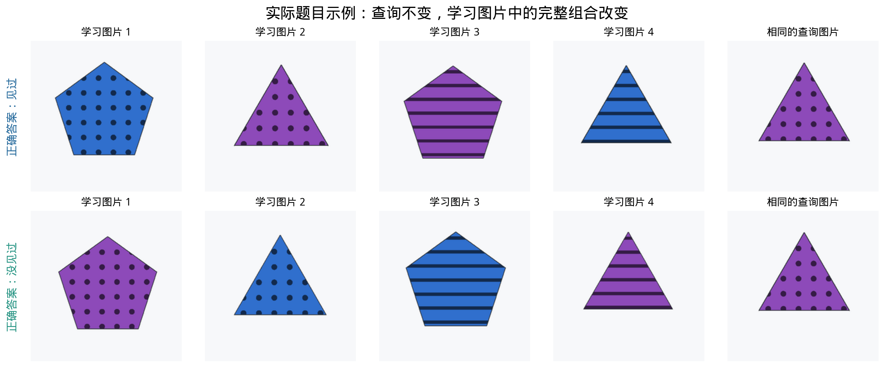

*图 1｜真实严格配对题目。每行左侧四张为学习图，右侧为查询图；上下两题分别独立输入模型。*

## 实验 1：先确认模型看得清属性

**实验目的：** 检查颜色、纹理和形状识别是否存在明显基础问题，为解释绑定错误提供参照。

**怎么做：** 每次只给一个物体，要求同时输出颜色、纹理和形状；覆盖二维、固定视角三维、另一三维视角和遮挡三维。

**正式测试规模：** 共 960 题，每种呈现 240 题。

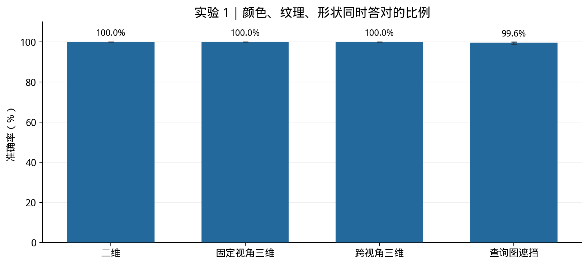

*图 2｜三个属性同时答对才记为正确。纵轴从 0 开始，顶部数值展示接近满分的细小差异。*

**结果：** 联合属性识别为 **99.90%**；前三种呈现均为 100%，遮挡为 99.58%。遮挡条件下有一条回答不符合允许的属性词表，严格评分记为错误。

**说明：** 简单单物体属性识别整体可靠，但这并不保证多物体学习后的查询同样容易，也不能排除后续任务中的视觉识别问题。

## 实验 2：基础绑定与不同诱饵

**实验目的：** 检验模型是否把“属性分别见过”误当成“完整物体见过”，并区分拒绝所有候选与真正识别。

**怎么做：** 每组学习 2、3 或 4 个物体，每张图放一个。判断题比较四类没见过的候选：所有属性全新、仅一类属性见过、仅两类属性见过、三类属性都见过但组合新。每类负例都配有真实出现过的正例。

**正式测试规模：** 图片、文字、图文三种判断各 5,760 题；其中目标 2,880 题，每类诱饵 720 题。另有二选一、四选一与属性回忆，见实验 4。

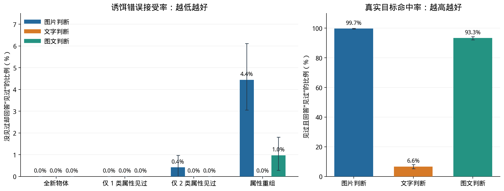

*图 3｜左：诱饵错误接受率，越低越好；右：真实目标命中率，越高越好。两图纵轴范围不同，不能直接比较柱子的视觉高度。*

**结果：** 图片判断对全新物体和只熟悉一类属性的诱饵均无误认，但对属性重组诱饵的误认率为 **4.44%**。文字判断对所有诱饵的误认率都是 0%，同时却只认出 **6.63%** 的真实目标。

**说明：** 低误认率必须结合目标命中率解释。文字查询在本任务下主要呈现“很少回答见过”的倾向，不能据此判断绑定能力更强。

## 实验 3：严格配对，检验完整三元组合

**实验目的：** 减少单个特征或两两特征熟悉程度的作用，要求模型区分完整颜色—纹理—形状组合。

**怎么做：** 构造两组各 4 个物体的学习集合：单个属性及所有属性对的出现次数一致，同一个查询物体只在其中一组出现。两题的查询图片/文字相同，正确答案一正一负。图 1 展示一组真实例子。

**正式测试规模：** 每种问法 480 题，来自 240 对；图片、文字、图文判断各有目标 240 题、严格重组诱饵 240 题。

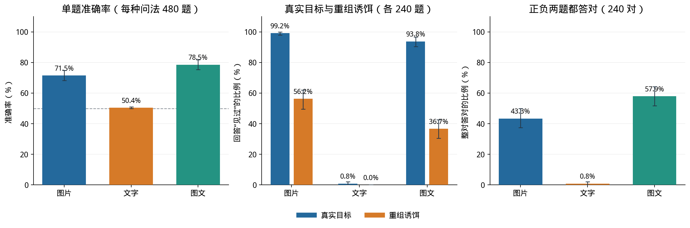

*图 4｜同一实验的三种读法。左：单题准确率，虚线为均衡判断题的 50% 参照；中：目标命中与诱饵误认；右：同一对正负题都正确的比例。*

**结果：** 图片判断准确率为 **71.46%**，能认出 240 个真实目标中的 238 个，却将 **56.25%** 的严格诱饵误认成见过；正负两题同时答对的比例只有 **43.33%**。文字判断仅认出 240 个目标中的 2 个，负例全部答对，得到 **50.42%** 的总准确率。

**说明：** “约 50%”不意味着随机猜测；这里文字回答几乎总是拒绝。图片判断则更愿意接受候选，却对复杂重组有明显误认。

## 实验 4：同样的学习材料，换一种问法

**实验目的：** 检查输入信息、候选布局和回答形式对表现的影响，避免只用一个提问模板代表模型能力。

**怎么做：** 比较图片/文字/图文判断、同图/分图二选一、四选一和属性回忆。图片、文字、图文判断按相同查询语义配对；同图与分图二选一保持候选身份、顺序和学习内容一致。四选一、回忆属于补充任务，不与判断题混合计算总分。

**正式测试规模：** 严格绑定各问法 480 题，多物体绑定各 3,360 题，三维扩展各 1,920 题。基础绑定的三种判断各 5,760 题，三种选择各 2,880 题，回忆 720 题。

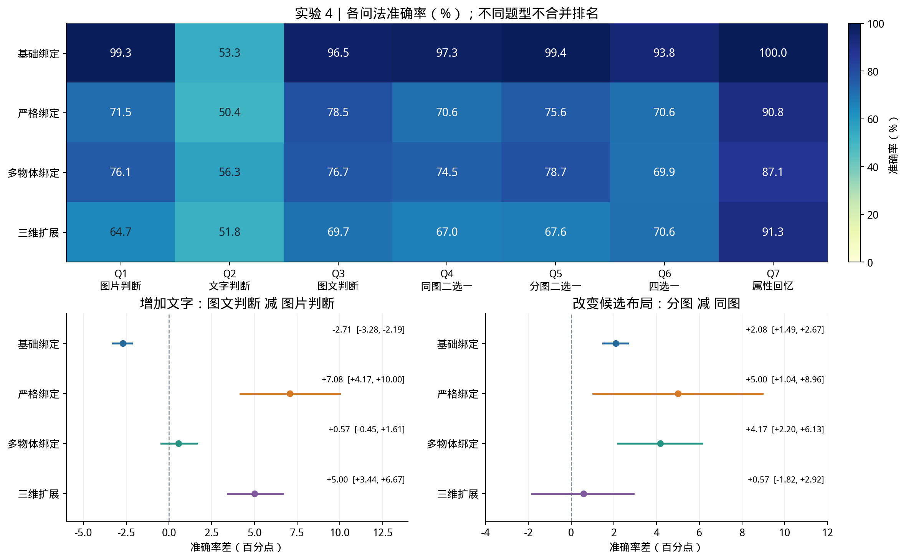

*图 5｜上：各任务准确率总览，热图只展示数值，不能忽略不同任务的线索和猜测概率。下：真正可配对的问法差异及 95% 区间；标注单位为百分点。*

**结果：** 在严格绑定中，图文判断相对图片判断提高 **+7.08 个百分点（95% 区间 +4.17 至 +10.00）**；但基础绑定下降，多物体绑定的差值区间跨过 0。分图二选一在严格绑定中提高 **+5.00 个百分点（95% 区间 +1.04 至 +8.96）**，多物体绑定提高 **+4.17 个百分点（95% 区间 +2.20 至 +6.13）**；三维汇总差异不明确。

**说明：** 没有一种问法在所有实验里都最好。严格任务中的四选一额外加入了两个在两组学习集合中均未出现的候选，四个候选并非同等熟悉。属性回忆先给颜色和形状，再问纹理，线索与输出空间都不同。因此，回忆分数高不能直接解释为“比判断更强的同一种记忆”。

## 实验 5：分开研究总数量与每图数量

**实验目的：** 检验总物体数和每图摆放数量各自对应什么变化，而非预设“越多越差”。

**怎么做：** 严格配对任务保持查询核心不变；总数为 8 时，在原有 4 个核心物体外加入 4 个两种世界共用的物体。总数 4 比较每图 1/2/4 个；总数 8 比较每图 1/2/4/8 个。固定总数比较布局，固定每图数量比较总数。

**正式测试规模：** 7 个数量条件，每条件、每问法 480 题；每种问法合计 3,360 题。

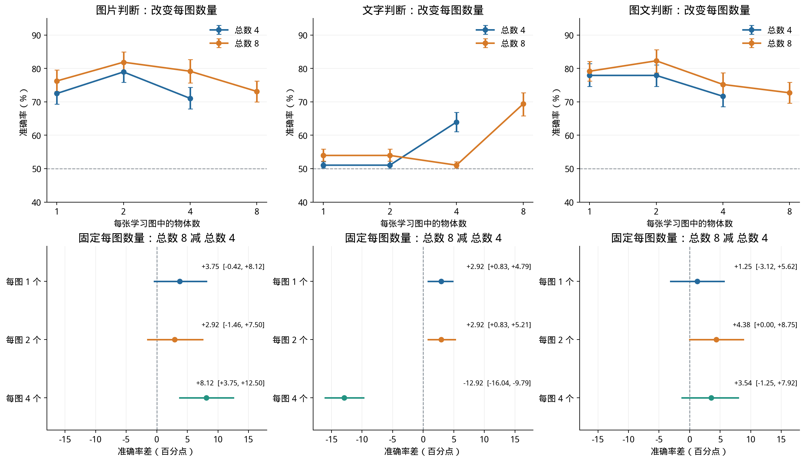

*图 6｜上排固定总数，观察每图数量变化；纵轴为 40%–95% 以便比较。下排固定每图数量，直接比较总数 8 减总数 4 的配对差异。*

**结果：** 图片判断在总数为 8 时，每图 1/2/4/8 个的准确率为 **76.25% / 81.88% / 79.17% / 73.12%**，并不单调。每图 4 个时，将总数从 4 增至 8，图片判断反而增加 +8.12 个百分点（95% 区间 +3.75 至 +12.50）。

**说明：** 本数据不支持简单的“数量越多，准确率越低”。布局变化还会改变图片数和视觉输入规模；这些因素没有完全分离，不能将差异解释成独立的记忆容量效应。

## 实验 6：物体不变，关系改变

**实验目的：** 检查模型能否利用物体之间的相对位置、深度和共同出现信息。

**怎么做：** 每对题保持物体身份相同，通过交换位置或调整分组，使同一个关系问题的正确答案发生变化。左右、上下、深度前后使用 2 个物体；共现使用 4 个物体、每图 2 个，改变哪两个共同出现。

**正式测试规模：** 每类关系 480 题、240 对；共 1,920 题。

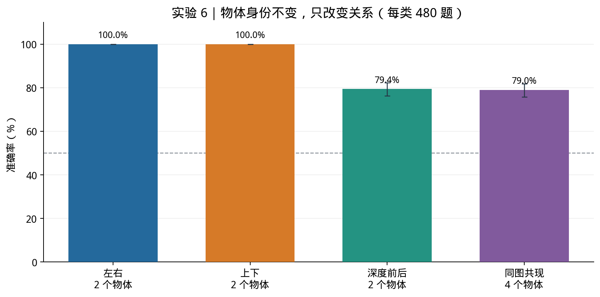

*图 7｜四种关系判断的准确率及 95% 区间。虚线为均衡 Yes/No 的 50% 参照；不同关系的视觉材料和物体数量并不完全一致。*

**结果：** 左右和上下均为 **100%**，深度前后为 **79.38%**，同图共现为 **78.96%**。

**说明：** 模型在这些简单左右/上下场景中表现可靠，但复杂关系并未同样达到满分。由于深度使用三维材料、共现使用更多物体，不能将四类分数差全部归因于抽象“关系类型”。

## 实验 7：三维、跨视角和查询图遮挡

**实验目的：** 检查二维结果能否延伸到受控三维物体，以及改变查询图的视角或可见性如何影响回答。

**怎么做：** 保持同组物体的属性语义和严格配对设计，比较二维、固定视角三维、跨视角三维、查询图部分遮挡。三维物体由二维轮廓挤出成网格并做深度遮挡渲染；跨视角/遮挡操作施加在查询图上。

**正式测试规模：** 每种模式、每种问法 480 题；4 种模式 × 7 种问法，共 13,440 题。

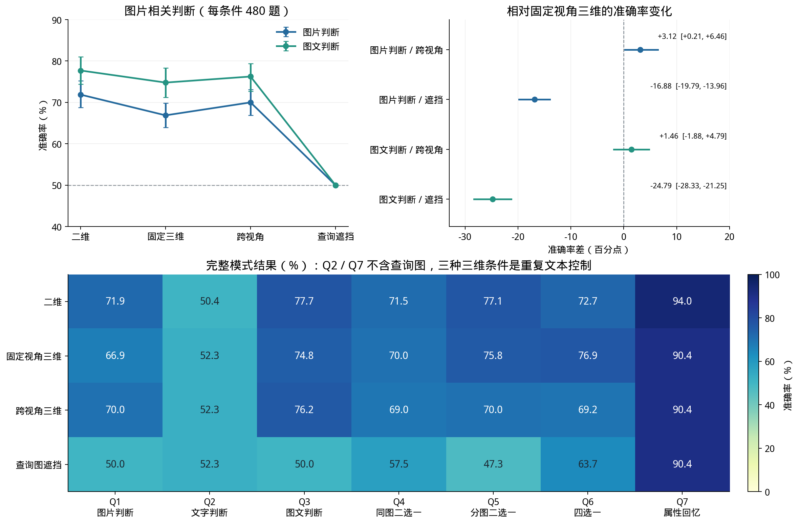

*图 8｜上左：图片与图文判断随模式变化，纵轴为 40%–90%；上右：以固定视角三维为基准的配对差异。下：所有问法分模式结果；Q2/Q7 的三种三维条件没有查询图变化，不是独立视觉实验。*

**结果：** 图片判断由固定视角三维的 **66.88%** 降至查询遮挡的 **50.00%**，差值为 -16.88 个百分点（95% 区间 -19.79 至 -13.96）。图文判断对应从 **74.79%** 降至 **50.00%**。跨视角本身没有呈现预设的稳定下降：图片判断略升，图文判断差值区间跨过 0。

**说明：** 遮挡可能降低查询物体本身的可识别性，所以下降不能直接等同于忘记学习内容。文字判断与属性回忆没有查询图片，其三维模式下重复输入的结果不能被当成额外独立证据。

## 逐任务成功率：把强重组诱饵单独列出

这里的“成功率”统一指模型答对的比例，不是程序运行完成率。以下全部来自正式 test；无效回答计错。每格同时列出正确题数/总题数，百分比按整数计数四舍五入。不要把“目标命中率”“诱饵正确拒绝率”和“正负合计准确率”混为一项。

**两类重组必须区分：** 基础绑定中的普通重组，只要求三种属性分别出现过，不要求所有属性对都出现；严格绑定、多物体绑定和三维扩展中的强重组，则要求三种两两属性组合全部在学习物体上出现过，但完整三元组从未出现。强重组题的正确答案是 NO。

### 先看最关心的强重组任务

每个条件将真实目标与强重组诱饵配平。下表里的“拒绝成功”是回答正确的 NO；拒绝率很高但目标命中率很低，可能只是偏向一律回答 NO。

| 任务 | 问法 | 真实目标命中率 | 强重组正确拒绝率 | 正负合计准确率 |
| --- | --- | --- | --- | --- |
| 严格绑定 | 图片判断 | **99.17%**（238/240） | **43.75%**（105/240） | **71.46%**（343/480） |
| 严格绑定 | 文字判断 | **0.83%**（2/240） | **100.00%**（240/240） | **50.42%**（242/480） |
| 严格绑定 | 图片＋文字判断 | **93.75%**（225/240） | **63.33%**（152/240） | **78.54%**（377/480） |
| 多物体绑定 | 图片判断 | **95.12%**（1598/1680） | **57.14%**（960/1680） | **76.13%**（2558/3360） |
| 多物体绑定 | 文字判断 | **14.40%**（242/1680） | **98.27%**（1651/1680） | **56.34%**（1893/3360） |
| 多物体绑定 | 图片＋文字判断 | **86.73%**（1457/1680） | **66.67%**（1120/1680） | **76.70%**（2577/3360） |
| 三维扩展 | 图片判断 | **73.75%**（708/960） | **55.63%**（534/960） | **64.69%**（1242/1920） |
| 三维扩展 | 文字判断 | **3.96%**（38/960） | **99.69%**（957/960） | **51.82%**（995/1920） |
| 三维扩展 | 图片＋文字判断 | **68.96%**（662/960） | **70.42%**（676/960） | **69.69%**（1338/1920） |

例如严格绑定的图片查询：240 道目标答对 238 道，240 道强重组负例只正确拒绝 105 道，因此总准确率是 (238+105)/480=71.46%。56.25% 是误认率，43.75% 才是这类负例的成功率。文字查询虽然拒绝了全部 240 道强重组负例，但只认出 2 道目标，因此不能认为它解决了绑定问题。

三维汇总含四种模式。文字查询的三个三维模式输入重复，因此这个汇总不是三份独立的视觉变化证据；后面的分模式表更适合解释具体条件。


蓝色：真实目标命中率；橙色：强重组正确拒绝率。两者越高越好。误差线为按组计算的 95% 区间。

### 所有物体任务的问法总览

| 输入与输出形式 | 基础绑定 | 严格绑定 | 多物体绑定 | 三维扩展 |
| --- | --- | --- | --- | --- |
| Q1 图片判断 | **99.25%**（5717/5760） | **71.46%**（343/480） | **76.13%**（2558/3360） | **64.69%**（1242/1920） |
| Q2 文字判断 | **53.32%**（3071/5760） | **50.42%**（242/480） | **56.34%**（1893/3360） | **51.82%**（995/1920） |
| Q3 图片＋文字判断 | **96.55%**（5561/5760） | **78.54%**（377/480） | **76.70%**（2577/3360） | **69.69%**（1338/1920） |
| Q4 同图二选一 | **97.33%**（2803/2880） | **70.63%**（339/480） | **74.52%**（2504/3360） | **66.98%**（1286/1920） |
| Q5 分图二选一 | **99.41%**（2863/2880） | **75.63%**（363/480） | **78.69%**（2644/3360） | **67.55%**（1297/1920） |
| Q6 四选一 | **93.82%**（2702/2880） | **70.63%**（339/480） | **69.94%**（2350/3360） | **70.63%**（1356/1920） |
| Q7 属性回忆 | **100.00%**（720/720） | **90.83%**（436/480） | **87.14%**（2928/3360） | **91.30%**（1753/1920） |

Q1：给候选图片，回答是否见过；Q2：只用文字描述候选，学习阶段仍是图片；Q3：同时给图片与属性文字；Q4/Q5：同图或分图的二选一；Q6：四选一；Q7：给颜色和形状、回忆纹理。不同问法的线索和输出空间不同，不计算跨题型总分。

### 属性识别：看清一个物体的三个属性

| 呈现条件 | 三个属性同时答对 |
| --- | --- |
| 二维 | **100.00%**（240/240） |
| 固定视角三维 | **100.00%**（240/240） |
| 跨视角三维 | **100.00%**（240/240） |
| 查询图遮挡 | **99.58%**（239/240） |
| 合计 | **99.90%**（959/960） |

这里要求颜色、纹理、形状全部正确。遮挡校准中的一个无效输出按错计分。100% 只表示当前样本全部答对，不保证未见样本零错误。

### 基础绑定：目标和四类诱饵分别表现如何

| 候选类型与正确行为 | 图片查询 | 文字查询 | 图片＋文字 |
| --- | --- | --- | --- |
| 真实出现过的目标：应答 YES | **99.72%**（2872/2880） | **6.63%**（191/2880） | **93.33%**（2688/2880） |
| 三种属性全新：应答 NO | **100.00%**（720/720） | **100.00%**（720/720） | **100.00%**（720/720） |
| 仅一类属性见过：应答 NO | **100.00%**（720/720） | **100.00%**（720/720） | **100.00%**（720/720） |
| 仅两类属性见过：应答 NO | **99.58%**（717/720） | **100.00%**（720/720） | **100.00%**（720/720） |
| 普通属性重组：应答 NO | **95.56%**（688/720） | **100.00%**（720/720） | **99.03%**（713/720） |

目标行是命中率，四类负例行是正确拒绝率。本表普通重组不等于“两两组合全出现”的强重组，不能用它替代前面的强重组成绩。

基础任务再按学习物体总数拆分，每张学习图始终只有一个物体：

| 学习物体数 | 图片判断 | 文字判断 | 图片＋文字判断 | 同图二选一 | 分图二选一 | 四选一 | 属性回忆 |
| --- | --- | --- | --- | --- | --- | --- | --- |
| 2 | **99.17%**（1904/1920） | **50.63%**（972/1920） | **90.99%**（1747/1920） | **96.35%**（925/960） | **99.69%**（957/960） | **95.83%**（920/960） | **100.00%**（240/240） |
| 3 | **99.64%**（1913/1920） | **56.67%**（1088/1920） | **99.90%**（1918/1920） | **98.75%**（948/960） | **99.79%**（958/960） | **95.21%**（914/960） | **100.00%**（240/240） |
| 4 | **98.96%**（1900/1920） | **52.66%**（1011/1920） | **98.75%**（1896/1920） | **96.88%**（930/960） | **98.75%**（948/960） | **90.42%**（868/960） | **100.00%**（240/240） |

### 严格绑定：两道反事实题能否都答对

| 问法 | 同一正负世界的两题都正确 |
| --- | --- |
| 图片判断 | **43.33%**（104/240 对） |
| 文字判断 | **0.83%**（2/240 对） |
| 图片＋文字判断 | **57.92%**（139/240 对） |
| 同图二选一 | **45.00%**（108/240 对） |
| 分图二选一 | **52.92%**（127/240 对） |
| 四选一 | **45.00%**（108/240 对） |
| 属性回忆 | **82.08%**（197/240 对） |

每题仍是独立模型输入；这里事后将对应的两题放在一起评分。总是输出同一个答案可能得到约 50% 的单题分数，却无法同时答对正负两题。选择题两世界正确选项不同，回忆题两世界正确纹理也不同。

### 多物体任务：每种数量和布局的成功率

| 总物体数 | 每图物体数 | 图片判断 | 文字判断 | 图片＋文字判断 | 同图二选一 | 分图二选一 | 四选一 | 属性回忆 |
| --- | --- | --- | --- | --- | --- | --- | --- | --- |
| 4 | 1 | **72.50%**（348/480） | **51.04%**（245/480） | **77.92%**（374/480） | **68.96%**（331/480） | **79.17%**（380/480） | **69.79%**（335/480） | **88.96%**（427/480） |
| 4 | 2 | **78.96%**（379/480） | **51.04%**（245/480） | **77.92%**（374/480） | **77.50%**（372/480） | **76.67%**（368/480） | **72.71%**（349/480） | **79.58%**（382/480） |
| 4 | 4 | **71.04%**（341/480） | **63.96%**（307/480） | **71.67%**（344/480） | **77.08%**（370/480） | **80.00%**（384/480） | **74.38%**（357/480） | **86.67%**（416/480） |
| 8 | 1 | **76.25%**（366/480） | **53.96%**（259/480） | **79.17%**（380/480） | **75.42%**（362/480） | **82.08%**（394/480） | **64.58%**（310/480） | **87.29%**（419/480） |
| 8 | 2 | **81.88%**（393/480） | **53.96%**（259/480） | **82.29%**（395/480） | **71.67%**（344/480） | **72.92%**（350/480） | **64.79%**（311/480） | **86.88%**（417/480） |
| 8 | 4 | **79.17%**（380/480） | **51.04%**（245/480） | **75.21%**（361/480） | **72.71%**（349/480） | **74.79%**（359/480） | **69.58%**（334/480） | **87.50%**（420/480） |
| 8 | 8 | **73.13%**（351/480） | **69.38%**（333/480） | **72.71%**（349/480） | **78.33%**（376/480） | **85.21%**（409/480） | **73.75%**（354/480） | **93.13%**（447/480） |

每格 480 题；二元判断内含 240 个目标和 240 个强重组诱饵。各条件成绩不能简单概括为“数量越大越低”。

同一批数量实验中的**强重组负例单独正确拒绝率**：

| 数量条件 | 图片查询 | 文字查询 | 图片＋文字 |
| --- | --- | --- | --- |
| 总数 4 / 每图 1 | **45.42%**（109/240） | **100.00%**（240/240） | **63.33%**（152/240） |
| 总数 4 / 每图 2 | **65.42%**（157/240） | **99.17%**（238/240） | **79.58%**（191/240） |
| 总数 4 / 每图 4 | **42.92%**（103/240） | **96.25%**（231/240） | **47.08%**（113/240） |
| 总数 8 / 每图 1 | **52.92%**（127/240） | **99.58%**（239/240） | **61.25%**（147/240） |
| 总数 8 / 每图 2 | **69.17%**（166/240） | **99.58%**（239/240） | **83.33%**（200/240） |
| 总数 8 / 每图 4 | **73.75%**（177/240） | **100.00%**（240/240） | **80.83%**（194/240） |
| 总数 8 / 每图 8 | **50.42%**（121/240） | **93.33%**（224/240） | **51.25%**（123/240） |

### 空间关系：四类关系分别评分

| 关系任务 | 答对率 |
| --- | --- |
| 左右：2 个物体 | **100.00%**（480/480） |
| 上下：2 个物体 | **100.00%**（480/480） |
| 深度前后：2 个物体 | **79.38%**（381/480） |
| 同图共现：4 个物体、每图 2 个 | **78.96%**（379/480） |

共现任务问两个指定物体是否在同一张学习图出现。不同关系的材料和物体数量不同，跨关系分数差不能完全解释为关系本身的难度差。

### 三维任务：分模式报告，避免遮挡被平均掉

| 模式 | 图片判断 | 文字判断 | 图片＋文字判断 | 同图二选一 | 分图二选一 | 四选一 | 属性回忆 |
| --- | --- | --- | --- | --- | --- | --- | --- |
| 二维 | **71.88%**（345/480） | **50.42%**（242/480） | **77.71%**（373/480） | **71.46%**（343/480） | **77.08%**（370/480） | **72.71%**（349/480） | **93.96%**（451/480） |
| 固定视角三维 | **66.88%**（321/480） | **52.29%**（251/480） | **74.79%**（359/480） | **70.00%**（336/480） | **75.83%**（364/480） | **76.88%**（369/480） | **90.42%**（434/480） |
| 跨视角三维 | **70.00%**（336/480） | **52.29%**（251/480） | **76.25%**（366/480） | **68.96%**（331/480） | **70.00%**（336/480） | **69.17%**（332/480） | **90.42%**（434/480） |
| 查询图遮挡 | **50.00%**（240/480） | **52.29%**（251/480） | **50.00%**（240/480） | **57.50%**（276/480） | **47.29%**（227/480） | **63.75%**（306/480） | **90.42%**（434/480） |

每格 480 题。跨视角/遮挡施加在查询图上。Q2/Q7 无查询图片，三个三维模式的输入重复；重复分数不是独立的视觉效应证据。

各模式中的**强重组负例单独正确拒绝率**：

| 模式 | 图片查询 | 文字查询 | 图片＋文字 |
| --- | --- | --- | --- |
| 二维 | **45.83%**（110/240） | **100.00%**（240/240） | **64.17%**（154/240） |
| 固定视角三维 | **33.75%**（81/240） | **99.58%**（239/240） | **55.42%**（133/240） |
| 跨视角三维 | **42.92%**（103/240） | **99.58%**（239/240） | **62.08%**（149/240） |
| 查询图遮挡 | **100.00%**（240/240） | **99.58%**（239/240） | **100.00%**（240/240） |

遮挡条件的图片与图文判断均将 480 题全部回答 NO：240 道负例全对、240 道目标全错，因此负例拒绝率为 100%，目标命中率为 0%，总准确率只有 50%。这不是可靠识别强重组的证据。

注意：负例拒绝率不能单独代表整体能力。例如全部答 NO 会拒绝所有负例，却漏掉所有目标。因此应结合前面的目标命中率和正负合计分数阅读。遮挡也可能降低候选本身可识别性，不能只归因于记忆失败。

### 无效输出是否被排除了？

没有。正式测试共 436 条无效输出，全部按错误计分；例如二选一回答 C/D 会直接记错。本报告显示的是含无效输出的成功率。所有分母为实际完成题数，当前无最终运行失败或缺失题。

完整分数与按组置信区间见 `task_success_rates.csv`；统计来源为已评分的正式逐题结果，读取后重新核对了全量覆盖。解释输入与原始回复的例子见 `input_output_report.html`。

## 模型具体收到了什么，又输出了什么？

本节直接读取正式测试的 `inputs/test.jsonl`、独立的 `labels/test.jsonl` 和各批 `predictions.jsonl`。下面的英文是实际发送文本，图片来自实际输入，模型回复是原始记录，不是示意答案。常规例子按数据文件顺序选取；Q1–Q7 使用同一严格学习集合，便于横向理解。末尾的无效回答例子按诊断目的单独选取，不代表随机抽样。

### 一道题在程序中的实际结构

应用层只构造**一条 `role=user` 的多模态消息**，内容按下列顺序排列；并不是先让模型回答学习阶段，再发下一轮问题。处理器随后把文本和图片转换成模型输入，并添加开始生成回答的模板标记。

```text
user.content = [
  任务规则文本,
  "Study image 1:", 学习图片1,
  "Study image 2:", 学习图片2,
  ……本题的其余学习图片……,
  "End of study. Answer the following query.",
  本题查询内容（文字和/或图片，按下面实例所列顺序）
]
```

每题开头实际发送的共同规则：

```text
Remember the study objects. Identity requires the SAME color, texture AND shape on one object. Position, size and viewpoint do not change identity. Shapes of 3D objects refer to their front silhouettes. 
```

中文含义：记住学习物体；颜色、纹理、形状必须同时属于同一个物体才算相同身份；位置、大小和视角不改变身份；三维物体的形状按正面轮廓理解。这里的中文解释仅供读者阅读，实际提示使用上方英文。

每题学习图结束后，实际追加：

```text
End of study. Answer the following query.
```

**标准答案不是输入。** 本文后面显示的标签、物体属性列表、trial ID、对错判断和错误类型，均属于读者解释或评测器记录，没有额外发送给模型。文字查询里明确写出的候选属性则属于正常问题内容。

| 任务 | 学习阶段 | 查询阶段 | 允许输出 |
|---|---|---|---|
| CAL 属性校准 | 1 张单物体图 | 识别三属性的文字指令 | 指定字段和词表的 JSON |
| Q1 图片判断 | 学习图片 | 候选图片＋Yes/No 问题 | YES / NO |
| Q2 文字判断 | 学习图片 | 候选属性文字＋Yes/No 问题 | YES / NO |
| Q3 图文判断 | 学习图片 | 候选图片＋候选属性文字＋问题 | YES / NO |
| Q4 同图二选一 | 学习图片 | 选择指令＋含 A/B 的一张候选图 | A / B |
| Q5 分图二选一 | 学习图片 | 选择指令＋A 标签和图＋B 标签和图 | A / B |
| Q6 四选一 | 学习图片 | 选择指令＋含 A–D 的一张候选图 | A / B / C / D |
| Q7 属性回忆 | 学习图片 | 给颜色和形状，询问纹理 | SOLID / STRIPES / DOTS / GRID |
| Q8 关系判断 | 关系场景图 | 指定物体与关系的文字问题 | YES / NO |

### 输入输出案例 1：属性识别

任务为 `L0/CAL`。学习阶段仅给一张单物体图，查询阶段没有额外图片；目标是识别当前物体的三种属性。

**输入 A · 学习阶段：** 共 1 张图片，合计 1 个物体，每张 1 个；下图按实际输入顺序排列。每张图前有 `Study image 序号:` 文本。

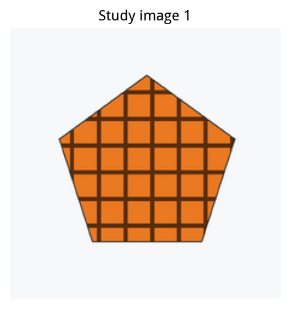

**输入 B · 查询阶段：** 以下按真正发送顺序展示；此前已发送共同规则、学习图与学习结束提示。

第 1 个查询内容块，文字原文：

```text
Identify the single study object. Output one JSON object with exactly color, texture, shape. Allowed values: color: red, yellow, blue, green, purple, orange; texture: solid, stripes, dots, grid; shape: circle, triangle, square, star, pentagon, hexagon.
```

**问题的中文解释（仅供读者，不是额外模型输入）：** 识别这张学习图中唯一物体的颜色、纹理、形状，并按指定 JSON 字段和词表输出。

**输出要求：** 一个 JSON 对象，恰好包含 color、texture、shape，值必须来自指定词表。

**模型实际输出：**

```text
{
  "color": "orange",
  "texture": "grid",
  "shape": "pentagon"
}
```

**评测器标准答案（不发送给模型）：**

```json
{"color": "orange", "shape": "pentagon", "texture": "grid"}
```

**如何评分：** 有效且正确：解析后的输出与标准答案完全一致。

追溯记录：`9b8da42a2aabf51b0bbff4820b15`；原始回复位于 `runs/bindmem_v2/qwen8b_core/predictions.jsonl`。完整消息、标签和评分另存于 `io_examples/cases.json` 的第 1 个案例。

### 输入输出案例 2：图片查询：判断是否见过

任务为 `L2/Q1`。查询阶段给一张候选物体图，文字仅问它是否作为完整物体出现过；并未直接用文字给出候选属性。

**输入 A · 学习阶段：** 共 4 张图片，合计 4 个物体，每张 1 个；下图按实际输入顺序排列。每张图前有 `Study image 序号:` 文本。

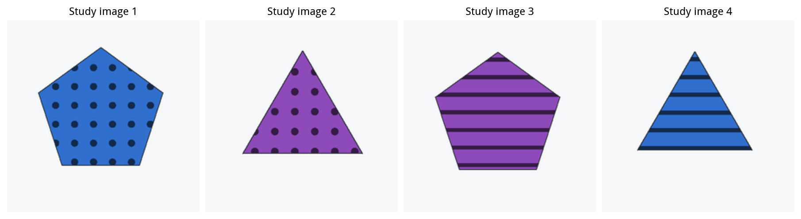

**输入 B · 查询阶段：** 以下按真正发送顺序展示；此前已发送共同规则、学习图与学习结束提示。

第 1 个查询内容块，图片：

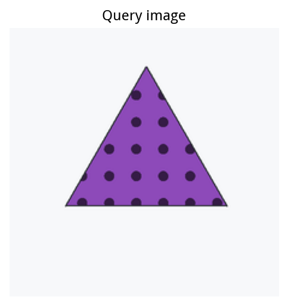

第 2 个查询内容块，文字原文：

```text
Did this complete object occur in the study set? Output only YES or NO.
```

**问题的中文解释（仅供读者，不是额外模型输入）：** 是否在学习集合中出现过“紫色、圆点、三角形”这个完整物体？

**输出要求：** 只回答 YES 或 NO。

**模型实际输出：**

```text
YES
```

**评测器标准答案（不发送给模型）：**

```text
YES
```

**如何评分：** 有效且正确：解析后的输出与标准答案完全一致。

**评分依据：** 独立标签检查查询物体的完整三元组存在于本题学习集合中；属性分别出现不等于完整组合出现。

追溯记录：`30c54a1e9f1f57c789a9530438b1`；原始回复位于 `runs/bindmem_v2/qwen8b_image/predictions.jsonl`。完整消息、标签和评分另存于 `io_examples/cases.json` 的第 2 个案例。

### 输入输出案例 3：文字查询：判断是否见过

任务为 `L2/Q2`。学习阶段仍然是图片；只有最终查询变成文字。它不是纯文本任务，也没有额外查询图。

**输入 A · 学习阶段：** 与案例 2 的学习图片完全相同，顺序也相同，共 4 张；本题仍会实际发送全部图片，并非省略学习输入。

**输入 B · 查询阶段：** 以下按真正发送顺序展示；此前已发送共同规则、学习图与学习结束提示。

第 1 个查询内容块，文字原文：

```text
The candidate is a purple dots triangle. Did this complete object occur in the study set? Output only YES or NO.
```

**问题的中文解释（仅供读者，不是额外模型输入）：** 是否在学习集合中出现过“紫色、圆点、三角形”这个完整物体？

**输出要求：** 只回答 YES 或 NO。

**模型实际输出：**

```text
NO
```

**评测器标准答案（不发送给模型）：**

```text
YES
```

**如何评分：** 有效但错误：真实目标被拒绝，属于漏认。

**评分依据：** 独立标签检查查询物体的完整三元组存在于本题学习集合中；属性分别出现不等于完整组合出现。

追溯记录：`99009b1cc07e5afffd89f679f96a`；原始回复位于 `runs/bindmem_v2/qwen8b_core/predictions.jsonl`。完整消息、标签和评分另存于 `io_examples/cases.json` 的第 3 个案例。

### 输入输出案例 4：图片＋文字：判断是否见过

任务为 `L2/Q3`。候选图片与文字描述指向同一个物体；与 Q1 相比多了属性文字，与 Q2 相比多了候选图。

**输入 A · 学习阶段：** 与案例 2 的学习图片完全相同，顺序也相同，共 4 张；本题仍会实际发送全部图片，并非省略学习输入。

**输入 B · 查询阶段：** 以下按真正发送顺序展示；此前已发送共同规则、学习图与学习结束提示。

第 1 个查询内容块，图片：


第 2 个查询内容块，文字原文：

```text
The candidate is a purple dots triangle. Did this complete object occur in the study set? Output only YES or NO.
```

**问题的中文解释（仅供读者，不是额外模型输入）：** 是否在学习集合中出现过“紫色、圆点、三角形”这个完整物体？

**输出要求：** 只回答 YES 或 NO。

**模型实际输出：**

```text
YES
```

**评测器标准答案（不发送给模型）：**

```text
YES
```

**如何评分：** 有效且正确：解析后的输出与标准答案完全一致。

**评分依据：** 独立标签检查查询物体的完整三元组存在于本题学习集合中；属性分别出现不等于完整组合出现。

追溯记录：`7af88ba43b480c3ff38983bc4561`；原始回复位于 `runs/bindmem_v2/qwen8b_formats/predictions.jsonl`。完整消息、标签和评分另存于 `io_examples/cases.json` 的第 4 个案例。

### 输入输出案例 5：同一张图中的二选一

任务为 `L2/Q4`。候选 A、B 画在同一张图中；字母本身位于图片上。只有一个候选属于学习集合。

**输入 A · 学习阶段：** 与案例 2 的学习图片完全相同，顺序也相同，共 4 张；本题仍会实际发送全部图片，并非省略学习输入。

**输入 B · 查询阶段：** 以下按真正发送顺序展示；此前已发送共同规则、学习图与学习结束提示。

第 1 个查询内容块，文字原文：

```text
Which ONE candidate occurred as a complete study object? Output only its letter.
```

第 2 个查询内容块，图片：

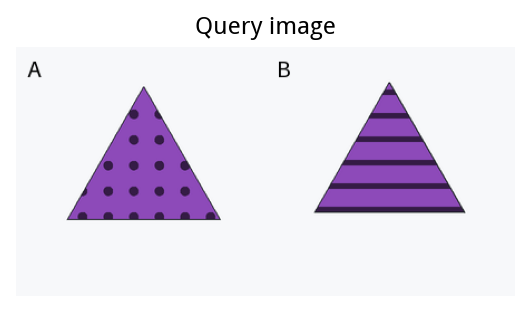

**问题的中文解释（仅供读者，不是额外模型输入）：** 这些候选中，哪一个曾作为完整物体出现在学习集合里？只回答它的字母。

**输出要求：** 只回答 A 或 B。

**模型实际输出：**

```text
B
```

**评测器标准答案（不发送给模型）：**

```text
A
```

**如何评分：** 有效但错误：输出格式合法，但选项或属性与标准答案不一致。

**评分依据（来自独立标签，不作为额外输入）：**

| 选项 | 候选完整属性 | 是否属于学习集合 |
|---|---|---|
| A | 紫色、圆点、三角形 | 是 |
| B | 紫色、条纹、三角形 | 否 |

仅一个候选完整出现。模型应输出对应字母，不要求输出属性描述。

追溯记录：`67e047b996584a5bd34995efce7a`；原始回复位于 `runs/bindmem_v2/qwen8b_choices/predictions.jsonl`。完整消息、标签和评分另存于 `io_examples/cases.json` 的第 5 个案例。

### 输入输出案例 6：两张候选图中的二选一

任务为 `L2/Q5`。候选 A、B 分别提供为两张图片；每张图前附 Candidate A 或 Candidate B。候选和顺序与对应 Q4 一致。

**输入 A · 学习阶段：** 与案例 2 的学习图片完全相同，顺序也相同，共 4 张；本题仍会实际发送全部图片，并非省略学习输入。

**输入 B · 查询阶段：** 以下按真正发送顺序展示；此前已发送共同规则、学习图与学习结束提示。

第 1 个查询内容块，文字原文：

```text
Which ONE candidate occurred as a complete study object? Output only its letter.
```

第 2 个查询内容块，文字原文：

```text
Candidate A
```

第 3 个查询内容块，图片：

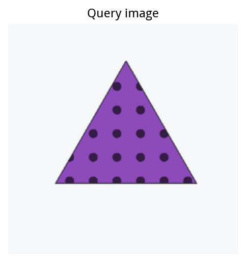

第 4 个查询内容块，文字原文：

```text
Candidate B
```

第 5 个查询内容块，图片：

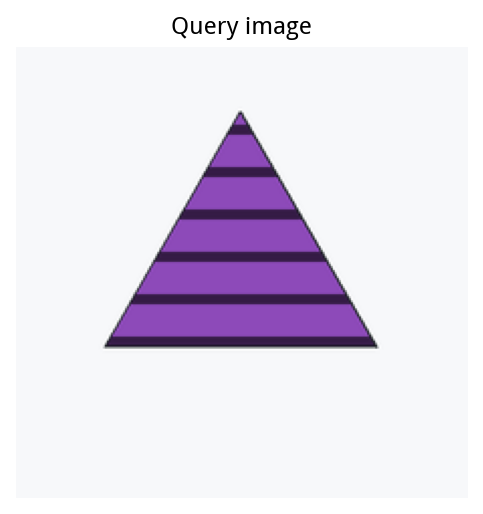

**问题的中文解释（仅供读者，不是额外模型输入）：** 这些候选中，哪一个曾作为完整物体出现在学习集合里？只回答它的字母。

**输出要求：** 只回答 A 或 B。

**模型实际输出：**

```text
A
```

**评测器标准答案（不发送给模型）：**

```text
A
```

**如何评分：** 有效且正确：解析后的输出与标准答案完全一致。

**评分依据（来自独立标签，不作为额外输入）：**

| 选项 | 候选完整属性 | 是否属于学习集合 |
|---|---|---|
| A | 紫色、圆点、三角形 | 是 |
| B | 紫色、条纹、三角形 | 否 |

仅一个候选完整出现。模型应输出对应字母，不要求输出属性描述。

追溯记录：`83feeb26124094ac10d01d7d4537`；原始回复位于 `runs/bindmem_v2/qwen8b_choices/predictions.jsonl`。完整消息、标签和评分另存于 `io_examples/cases.json` 的第 6 个案例。

### 输入输出案例 7：四选一

任务为 `L2/Q6`。A–D 四个候选画在同一张图中。严格绑定任务中，两个额外候选在两种学习世界中都未出现。

**输入 A · 学习阶段：** 与案例 2 的学习图片完全相同，顺序也相同，共 4 张；本题仍会实际发送全部图片，并非省略学习输入。

**输入 B · 查询阶段：** 以下按真正发送顺序展示；此前已发送共同规则、学习图与学习结束提示。

第 1 个查询内容块，文字原文：

```text
Which ONE candidate occurred as a complete study object? Output only its letter.
```

第 2 个查询内容块，图片：

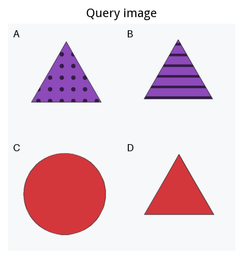

**问题的中文解释（仅供读者，不是额外模型输入）：** 这些候选中，哪一个曾作为完整物体出现在学习集合里？只回答它的字母。

**输出要求：** 只回答 A、B、C 或 D。

**模型实际输出：**

```text
B
```

**评测器标准答案（不发送给模型）：**

```text
A
```

**如何评分：** 有效但错误：输出格式合法，但选项或属性与标准答案不一致。

**评分依据（来自独立标签，不作为额外输入）：**

| 选项 | 候选完整属性 | 是否属于学习集合 |
|---|---|---|
| A | 紫色、圆点、三角形 | 是 |
| B | 紫色、条纹、三角形 | 否 |
| C | 红色、纯色、圆形 | 否 |
| D | 红色、纯色、三角形 | 否 |

仅一个候选完整出现。模型应输出对应字母，不要求输出属性描述。

追溯记录：`7974e7bd191ce8e89df4a7f2ca70`；原始回复位于 `runs/bindmem_v2/qwen8b_formats/predictions.jsonl`。完整消息、标签和评分另存于 `io_examples/cases.json` 的第 7 个案例。

### 输入输出案例 8：给颜色和形状，回忆纹理

任务为 `L2/Q7`。颜色和形状作为定位线索，问题不直接给出纹理，也不提供查询图片；生成器保证线索唯一对应一个学习物体。

**输入 A · 学习阶段：** 与案例 2 的学习图片完全相同，顺序也相同，共 4 张；本题仍会实际发送全部图片，并非省略学习输入。

**输入 B · 查询阶段：** 以下按真正发送顺序展示；此前已发送共同规则、学习图与学习结束提示。

第 1 个查询内容块，文字原文：

```text
What texture did the purple triangle have in the study set? Output only SOLID, STRIPES, DOTS or GRID.
```

**问题的中文解释（仅供读者，不是额外模型输入）：** 学习集合中，紫色、三角形的物体是什么纹理？

**输出要求：** 只回答 SOLID、STRIPES、DOTS 或 GRID。

**模型实际输出：**

```text
DOTS
```

**评测器标准答案（不发送给模型）：**

```text
DOTS
```

**如何评分：** 有效且正确：解析后的输出与标准答案完全一致。

评分依据是学习集合中与颜色、形状线索匹配的物体纹理，而不是把查询候选的完整三元组直接当作答案。

追溯记录：`c1441490c1e6574f934d6ce8e544`；原始回复位于 `runs/bindmem_v2/qwen8b_formats/predictions.jsonl`。完整消息、标签和评分另存于 `io_examples/cases.json` 的第 8 个案例。

### 输入输出案例 9：严格负例：图片查询：判断是否见过

任务为 `L2/Q1`。查询阶段给一张候选物体图，文字仅问它是否作为完整物体出现过；并未直接用文字给出候选属性。

**输入 A · 学习阶段：** 共 4 张图片，合计 4 个物体，每张 1 个；下图按实际输入顺序排列。每张图前有 `Study image 序号:` 文本。

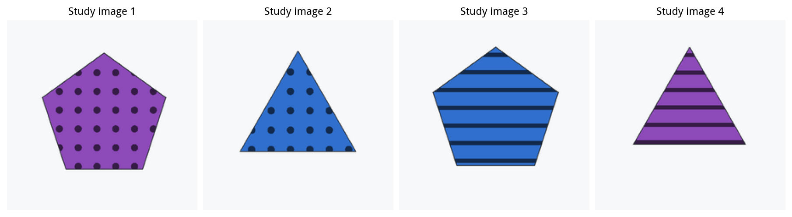

**输入 B · 查询阶段：** 以下按真正发送顺序展示；此前已发送共同规则、学习图与学习结束提示。

第 1 个查询内容块，图片：


第 2 个查询内容块，文字原文：

```text
Did this complete object occur in the study set? Output only YES or NO.
```

**问题的中文解释（仅供读者，不是额外模型输入）：** 是否在学习集合中出现过“紫色、圆点、三角形”这个完整物体？

**输出要求：** 只回答 YES 或 NO。

**模型实际输出：**

```text
NO
```

**评测器标准答案（不发送给模型）：**

```text
NO
```

**如何评分：** 有效且正确：解析后的输出与标准答案完全一致。

**评分依据：** 独立标签检查查询物体的完整三元组不存在于本题学习集合中；属性分别出现不等于完整组合出现。

追溯记录：`be3c5c28bbf84d857b635b546358`；原始回复位于 `runs/bindmem_v2/qwen8b_image/predictions.jsonl`。完整消息、标签和评分另存于 `io_examples/cases.json` 的第 9 个案例。

### 输入输出案例 10：严格负例：文字查询：判断是否见过

任务为 `L2/Q2`。学习阶段仍然是图片；只有最终查询变成文字。它不是纯文本任务，也没有额外查询图。

**输入 A · 学习阶段：** 与案例 9 的学习图片完全相同，顺序也相同，共 4 张；本题仍会实际发送全部图片，并非省略学习输入。

**输入 B · 查询阶段：** 以下按真正发送顺序展示；此前已发送共同规则、学习图与学习结束提示。

第 1 个查询内容块，文字原文：

```text
The candidate is a purple dots triangle. Did this complete object occur in the study set? Output only YES or NO.
```

**问题的中文解释（仅供读者，不是额外模型输入）：** 是否在学习集合中出现过“紫色、圆点、三角形”这个完整物体？

**输出要求：** 只回答 YES 或 NO。

**模型实际输出：**

```text
NO
```

**评测器标准答案（不发送给模型）：**

```text
NO
```

**如何评分：** 有效且正确：解析后的输出与标准答案完全一致。

**评分依据：** 独立标签检查查询物体的完整三元组不存在于本题学习集合中；属性分别出现不等于完整组合出现。

追溯记录：`fb59d24cc6c0e798d191d7a20e4e`；原始回复位于 `runs/bindmem_v2/qwen8b_core/predictions.jsonl`。完整消息、标签和评分另存于 `io_examples/cases.json` 的第 10 个案例。

### 输入输出案例 11：关系判断：左右

任务为 `L4/Q8`。使用文字描述要比较的物体和关系；查询阶段没有额外候选图，证据来自前面的学习图。

**输入 A · 学习阶段：** 共 1 张图片，合计 2 个物体，每张 2 个；下图按实际输入顺序排列。每张图前有 `Study image 序号:` 文本。

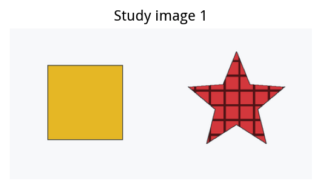

**输入 B · 查询阶段：** 以下按真正发送顺序展示；此前已发送共同规则、学习图与学习结束提示。

第 1 个查询内容块，文字原文：

```text
In the study image, was the yellow solid square to the left of the red grid star? Output only YES or NO.
```

**问题的中文解释（仅供读者，不是额外模型输入）：** 第一个物体为“黄色、纯色、正方形”，第二个为“红色、网格、星形”：第一个物体是否在第二个物体左侧？

**输出要求：** 只回答 YES 或 NO。

**模型实际输出：**

```text
YES
```

**评测器标准答案（不发送给模型）：**

```text
YES
```

**如何评分：** 有效且正确：解析后的输出与标准答案完全一致。

追溯记录：`bc0b710794d64cd67ef15de34e8e`；原始回复位于 `runs/bindmem_v2/qwen8b_extensions/predictions.jsonl`。完整消息、标签和评分另存于 `io_examples/cases.json` 的第 11 个案例。

### 输入输出案例 12：关系判断：上下

任务为 `L4/Q8`。使用文字描述要比较的物体和关系；查询阶段没有额外候选图，证据来自前面的学习图。

**输入 A · 学习阶段：** 共 1 张图片，合计 2 个物体，每张 2 个；下图按实际输入顺序排列。每张图前有 `Study image 序号:` 文本。

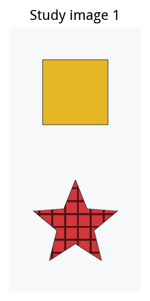

**输入 B · 查询阶段：** 以下按真正发送顺序展示；此前已发送共同规则、学习图与学习结束提示。

第 1 个查询内容块，文字原文：

```text
In the study image, was the yellow solid square above the red grid star? Output only YES or NO.
```

**问题的中文解释（仅供读者，不是额外模型输入）：** 第一个物体为“黄色、纯色、正方形”，第二个为“红色、网格、星形”：第一个物体是否在第二个物体上方？

**输出要求：** 只回答 YES 或 NO。

**模型实际输出：**

```text
YES
```

**评测器标准答案（不发送给模型）：**

```text
YES
```

**如何评分：** 有效且正确：解析后的输出与标准答案完全一致。

追溯记录：`131f0a8531cd231b9f29c40bcda0`；原始回复位于 `runs/bindmem_v2/qwen8b_extensions/predictions.jsonl`。完整消息、标签和评分另存于 `io_examples/cases.json` 的第 12 个案例。

### 输入输出案例 13：关系判断：深度前后

任务为 `L4/Q8`。使用文字描述要比较的物体和关系；查询阶段没有额外候选图，证据来自前面的学习图。

**输入 A · 学习阶段：** 共 1 张图片，合计 2 个物体，每张 2 个；下图按实际输入顺序排列。每张图前有 `Study image 序号:` 文本。

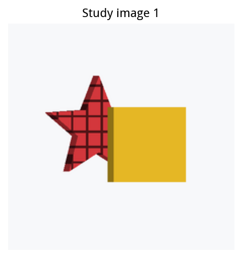

**输入 B · 查询阶段：** 以下按真正发送顺序展示；此前已发送共同规则、学习图与学习结束提示。

第 1 个查询内容块，文字原文：

```text
In the study image, was the yellow solid square in front of (closer to the camera than) the red grid star? Output only YES or NO.
```

**问题的中文解释（仅供读者，不是额外模型输入）：** 第一个物体为“黄色、纯色、正方形”，第二个为“红色、网格、星形”：第一个物体是否比第二个物体更靠近相机？

**输出要求：** 只回答 YES 或 NO。

**模型实际输出：**

```text
YES
```

**评测器标准答案（不发送给模型）：**

```text
YES
```

**如何评分：** 有效且正确：解析后的输出与标准答案完全一致。

追溯记录：`0da04c283236dc44275a92e9d207`；原始回复位于 `runs/bindmem_v2/qwen8b_extensions/predictions.jsonl`。完整消息、标签和评分另存于 `io_examples/cases.json` 的第 13 个案例。

### 输入输出案例 14：关系判断：同图共现

任务为 `L4/Q8`。使用文字描述要比较的物体和关系；查询阶段没有额外候选图，证据来自前面的学习图。

**输入 A · 学习阶段：** 共 2 张图片，合计 4 个物体，每张 2 个；下图按实际输入顺序排列。每张图前有 `Study image 序号:` 文本。

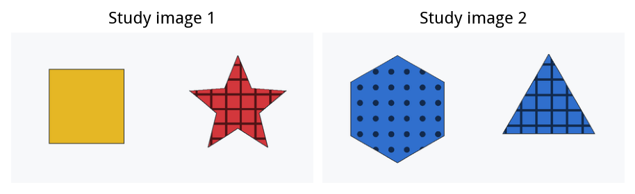

**输入 B · 查询阶段：** 以下按真正发送顺序展示；此前已发送共同规则、学习图与学习结束提示。

第 1 个查询内容块，文字原文：

```text
Did the yellow solid square and the red grid star occur together in the SAME study image? Output only YES or NO.
```

**问题的中文解释（仅供读者，不是额外模型输入）：** 第一个物体为“黄色、纯色、正方形”，第二个为“红色、网格、星形”：第一个物体是否曾与第二个物体出现在同一张学习图中？

**输出要求：** 只回答 YES 或 NO。

**模型实际输出：**

```text
YES
```

**评测器标准答案（不发送给模型）：**

```text
YES
```

**如何评分：** 有效且正确：解析后的输出与标准答案完全一致。

追溯记录：`5156e7376d67230f3c454981f143`；原始回复位于 `runs/bindmem_v2/qwen8b_extensions/predictions.jsonl`。完整消息、标签和评分另存于 `io_examples/cases.json` 的第 14 个案例。

### 输入输出案例 15：多物体输入：8 个物体、每图 4 个

任务为 `L3/Q1`。查询阶段给一张候选物体图，文字仅问它是否作为完整物体出现过；并未直接用文字给出候选属性。

**输入 A · 学习阶段：** 共 2 张图片，合计 8 个物体，每张 4 个；下图按实际输入顺序排列。每张图前有 `Study image 序号:` 文本。

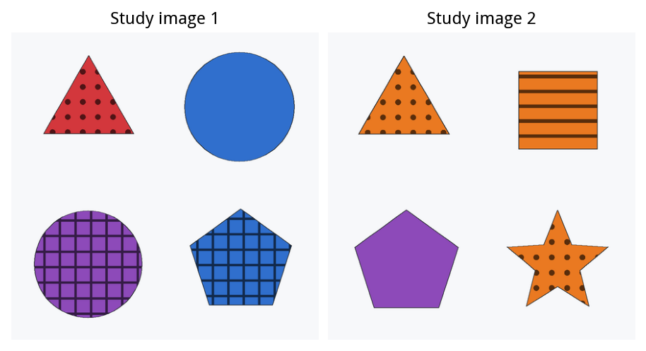

**输入 B · 查询阶段：** 以下按真正发送顺序展示；此前已发送共同规则、学习图与学习结束提示。

第 1 个查询内容块，图片：

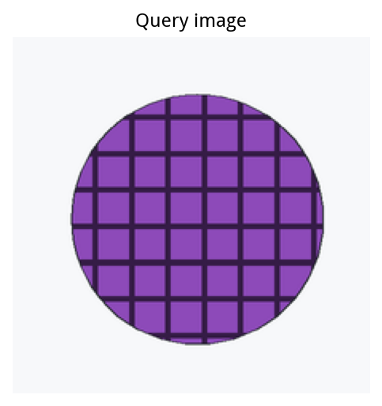

第 2 个查询内容块，文字原文：

```text
Did this complete object occur in the study set? Output only YES or NO.
```

**问题的中文解释（仅供读者，不是额外模型输入）：** 是否在学习集合中出现过“紫色、网格、圆形”这个完整物体？

**输出要求：** 只回答 YES 或 NO。

**模型实际输出：**

```text
YES
```

**评测器标准答案（不发送给模型）：**

```text
YES
```

**如何评分：** 有效且正确：解析后的输出与标准答案完全一致。

**评分依据：** 独立标签检查查询物体的完整三元组存在于本题学习集合中；属性分别出现不等于完整组合出现。

追溯记录：`3d8e98cd5701dbae886a4db35f4f`；原始回复位于 `runs/bindmem_v2/qwen8b_image/predictions.jsonl`。完整消息、标签和评分另存于 `io_examples/cases.json` 的第 15 个案例。

### 输入输出案例 16：三维输入：查询图部分遮挡

任务为 `L5/Q1`。查询阶段给一张候选物体图，文字仅问它是否作为完整物体出现过；并未直接用文字给出候选属性。

**输入 A · 学习阶段：** 共 4 张图片，合计 4 个物体，每张 1 个；下图按实际输入顺序排列。每张图前有 `Study image 序号:` 文本。

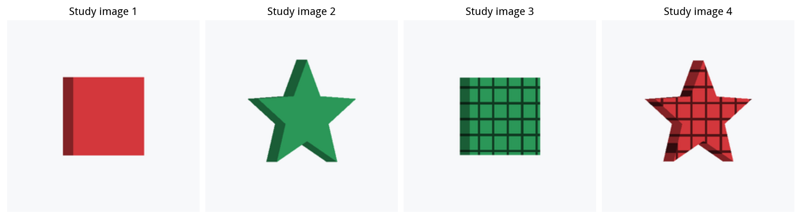

**输入 B · 查询阶段：** 以下按真正发送顺序展示；此前已发送共同规则、学习图与学习结束提示。

第 1 个查询内容块，图片：

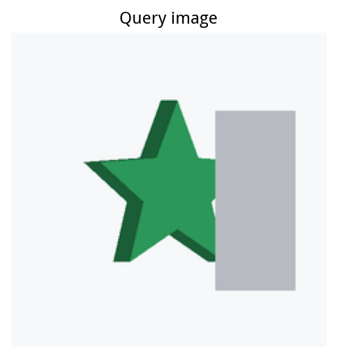

第 2 个查询内容块，文字原文：

```text
Did this complete object occur in the study set? Output only YES or NO.
```

**问题的中文解释（仅供读者，不是额外模型输入）：** 是否在学习集合中出现过“绿色、纯色、星形”这个完整物体？

**输出要求：** 只回答 YES 或 NO。

**模型实际输出：**

```text
NO
```

**评测器标准答案（不发送给模型）：**

```text
YES
```

**如何评分：** 有效但错误：真实目标被拒绝，属于漏认。

**评分依据：** 独立标签检查查询物体的完整三元组存在于本题学习集合中；属性分别出现不等于完整组合出现。

追溯记录：`9992fb76869cb16f03411130278e`；原始回复位于 `runs/bindmem_v2/qwen8b_extensions/predictions.jsonl`。完整消息、标签和评分另存于 `io_examples/cases.json` 的第 16 个案例。

### 输入输出案例 17：无效回答诊断：二选一却输出范围外字母

任务为 `L5/Q5`。候选 A、B 分别提供为两张图片；每张图前附 Candidate A 或 Candidate B。候选和顺序与对应 Q4 一致。

**输入 A · 学习阶段：** 共 4 张图片，合计 4 个物体，每张 1 个；下图按实际输入顺序排列。每张图前有 `Study image 序号:` 文本。

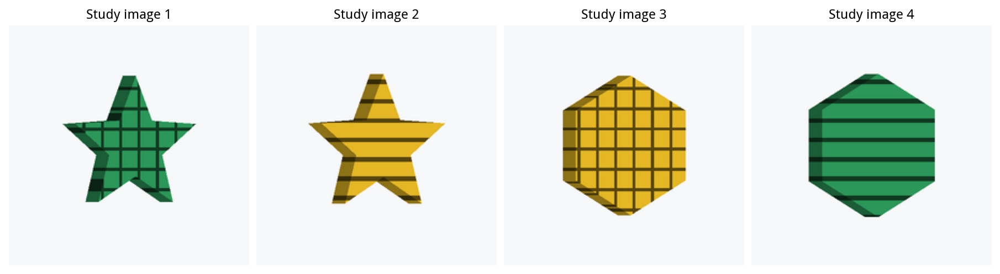

**输入 B · 查询阶段：** 以下按真正发送顺序展示；此前已发送共同规则、学习图与学习结束提示。

第 1 个查询内容块，文字原文：

```text
Which ONE candidate occurred as a complete study object? Output only its letter.
```

第 2 个查询内容块，文字原文：

```text
Candidate A
```

第 3 个查询内容块，图片：

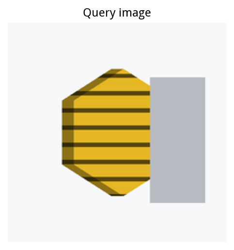

第 4 个查询内容块，文字原文：

```text
Candidate B
```

第 5 个查询内容块，图片：

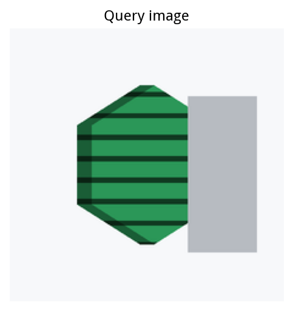

**问题的中文解释（仅供读者，不是额外模型输入）：** 这些候选中，哪一个曾作为完整物体出现在学习集合里？只回答它的字母。

**输出要求：** 只回答 A 或 B。

**模型实际输出：**

```text
D
```

**评测器标准答案（不发送给模型）：**

```text
B
```

**如何评分：** 无效回答，按错误计分。该输出不属于本题允许的答案集合；程序不会把越界字母猜测成另一个选项。

**评分依据（来自独立标签，不作为额外输入）：**

| 选项 | 候选完整属性 | 是否属于学习集合 |
|---|---|---|
| A | 黄色、条纹、六边形 | 否 |
| B | 绿色、条纹、六边形 | 是 |

仅一个候选完整出现。模型应输出对应字母，不要求输出属性描述。

追溯记录：`481db1a0877c5d3e882611f9c6c1`；原始回复位于 `runs/bindmem_v2/qwen8b_extensions/predictions.jsonl`。完整消息、标签和评分另存于 `io_examples/cases.json` 的第 17 个案例。

### 如何从单题回答得到报告中的指标

单题正确率把合法且与标签一致的回答计为正确，其他模型回答计错。目标命中率仅统计标签为 YES 的目标题；诱饵误认率仅统计相应标签为 NO 的诱饵题。严格配对的两题分别独立输入模型，只有正负两题都答对，整对才算正确。这里展示的例子用来解释流程；总体结论仍来自全部正式测试题，而不是这几个例子。

解析规则会去掉首尾空白，并将非 JSON 答案转为大写后与允许词表匹配；不会从长解释中抽取一个看起来像答案的词。校准 JSON 必须恰好包含指定字段，且三个值均在允许词表中。运行异常不作为模型判断，失败题会重试；合法性错误则保留并按错计分。

## 结果边界与可复查材料

目前只测试了 Qwen3-VL-8B 一个模型，图片为程序生成的受控物体；结论不能直接推广到所有视觉语言模型或自然照片。准确率、命中率、误认率和成对正确率回答不同问题，不能互相替代。本报告只讨论行为证据，不解释内部机制。

样本中 100% 只表示当前题目全部答对，不保证未见样本没有错误；样本全对时，重采样区间也可能退化为 100%–100%。正式结果没有把无效回答删去，因此选择题成绩同时反映选对候选和遵守输出格式的表现。

**已交付：** 全量行为实验与评分；按实验组织的设计说明；八张结果/设计图；分任务、分条件、配对统计和无效回答原文。其他模型可以后续使用相同协议验证，目前不在本报告结论范围内。

**数据来源：** `summary.json`；全精度表格见 `accuracy.csv`、`conditions.csv`、`paired_comparisons.csv`；异常输出见 `invalid_responses.csv`。图表使用的数值和区间另存为 `visual_figures/figure_data.csv`，示例题来源见 `visual_figures/example_provenance.json`。独立图集为 `实验结果图集.pdf`。
