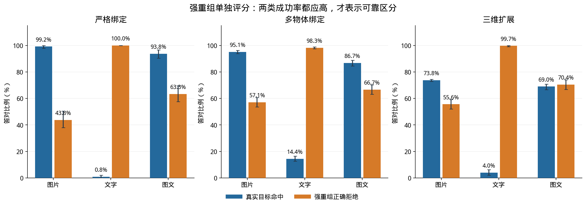

# 物体绑定实验：逐任务成功率与强重组诱饵

模型：Qwen3-VL-8B-Instruct。数据：bindmem_v2 正式测试集，69,840 题、240 个随机组。

## 逐任务成功率：把强重组诱饵单独列出

这里的“成功率”统一指模型答对的比例，不是程序运行完成率。以下全部来自正式 test；无效回答计错。每格同时列出正确题数/总题数，百分比按整数计数四舍五入。不要把“目标命中率”“诱饵正确拒绝率”和“正负合计准确率”混为一项。

**两类重组必须区分：** 基础绑定中的普通重组，只要求三种属性分别出现过，不要求所有属性对都出现；严格绑定、多物体绑定和三维扩展中的强重组，则要求三种两两属性组合全部在学习物体上出现过，但完整三元组从未出现。强重组题的正确答案是 NO。

### 先看最关心的强重组任务

每个条件将真实目标与强重组诱饵配平。下表里的“拒绝成功”是回答正确的 NO；拒绝率很高但目标命中率很低，可能只是偏向一律回答 NO。

| 任务 | 问法 | 真实目标命中率 | 强重组正确拒绝率 | 正负合计准确率 |
| --- | --- | --- | --- | --- |
| 严格绑定 | 图片判断 | **99.17%**（238/240） | **43.75%**（105/240） | **71.46%**（343/480） |
| 严格绑定 | 文字判断 | **0.83%**（2/240） | **100.00%**（240/240） | **50.42%**（242/480） |
| 严格绑定 | 图片＋文字判断 | **93.75%**（225/240） | **63.33%**（152/240） | **78.54%**（377/480） |
| 多物体绑定 | 图片判断 | **95.12%**（1598/1680） | **57.14%**（960/1680） | **76.13%**（2558/3360） |
| 多物体绑定 | 文字判断 | **14.40%**（242/1680） | **98.27%**（1651/1680） | **56.34%**（1893/3360） |
| 多物体绑定 | 图片＋文字判断 | **86.73%**（1457/1680） | **66.67%**（1120/1680） | **76.70%**（2577/3360） |
| 三维扩展 | 图片判断 | **73.75%**（708/960） | **55.63%**（534/960） | **64.69%**（1242/1920） |
| 三维扩展 | 文字判断 | **3.96%**（38/960） | **99.69%**（957/960） | **51.82%**（995/1920） |
| 三维扩展 | 图片＋文字判断 | **68.96%**（662/960） | **70.42%**（676/960） | **69.69%**（1338/1920） |

例如严格绑定的图片查询：240 道目标答对 238 道，240 道强重组负例只正确拒绝 105 道，因此总准确率是 (238+105)/480=71.46%。56.25% 是误认率，43.75% 才是这类负例的成功率。文字查询虽然拒绝了全部 240 道强重组负例，但只认出 2 道目标，因此不能认为它解决了绑定问题。

三维汇总含四种模式。文字查询的三个三维模式输入重复，因此这个汇总不是三份独立的视觉变化证据；后面的分模式表更适合解释具体条件。

蓝色：真实目标命中率；橙色：强重组正确拒绝率。两者越高越好。误差线为按组计算的 95% 区间。

### 所有物体任务的问法总览

| 输入与输出形式 | 基础绑定 | 严格绑定 | 多物体绑定 | 三维扩展 |
| --- | --- | --- | --- | --- |
| Q1 图片判断 | **99.25%**（5717/5760） | **71.46%**（343/480） | **76.13%**（2558/3360） | **64.69%**（1242/1920） |
| Q2 文字判断 | **53.32%**（3071/5760） | **50.42%**（242/480） | **56.34%**（1893/3360） | **51.82%**（995/1920） |
| Q3 图片＋文字判断 | **96.55%**（5561/5760） | **78.54%**（377/480） | **76.70%**（2577/3360） | **69.69%**（1338/1920） |
| Q4 同图二选一 | **97.33%**（2803/2880） | **70.63%**（339/480） | **74.52%**（2504/3360） | **66.98%**（1286/1920） |
| Q5 分图二选一 | **99.41%**（2863/2880） | **75.63%**（363/480） | **78.69%**（2644/3360） | **67.55%**（1297/1920） |
| Q6 四选一 | **93.82%**（2702/2880） | **70.63%**（339/480） | **69.94%**（2350/3360） | **70.63%**（1356/1920） |
| Q7 属性回忆 | **100.00%**（720/720） | **90.83%**（436/480） | **87.14%**（2928/3360） | **91.30%**（1753/1920） |

Q1：给候选图片，回答是否见过；Q2：只用文字描述候选，学习阶段仍是图片；Q3：同时给图片与属性文字；Q4/Q5：同图或分图的二选一；Q6：四选一；Q7：给颜色和形状、回忆纹理。不同问法的线索和输出空间不同，不计算跨题型总分。

### 属性识别：看清一个物体的三个属性

| 呈现条件 | 三个属性同时答对 |
| --- | --- |
| 二维 | **100.00%**（240/240） |
| 固定视角三维 | **100.00%**（240/240） |
| 跨视角三维 | **100.00%**（240/240） |
| 查询图遮挡 | **99.58%**（239/240） |
| 合计 | **99.90%**（959/960） |

这里要求颜色、纹理、形状全部正确。遮挡校准中的一个无效输出按错计分。100% 只表示当前样本全部答对，不保证未见样本零错误。

### 基础绑定：目标和四类诱饵分别表现如何

| 候选类型与正确行为 | 图片查询 | 文字查询 | 图片＋文字 |
| --- | --- | --- | --- |
| 真实出现过的目标：应答 YES | **99.72%**（2872/2880） | **6.63%**（191/2880） | **93.33%**（2688/2880） |
| 三种属性全新：应答 NO | **100.00%**（720/720） | **100.00%**（720/720） | **100.00%**（720/720） |
| 仅一类属性见过：应答 NO | **100.00%**（720/720） | **100.00%**（720/720） | **100.00%**（720/720） |
| 仅两类属性见过：应答 NO | **99.58%**（717/720） | **100.00%**（720/720） | **100.00%**（720/720） |
| 普通属性重组：应答 NO | **95.56%**（688/720） | **100.00%**（720/720） | **99.03%**（713/720） |

目标行是命中率，四类负例行是正确拒绝率。本表普通重组不等于“两两组合全出现”的强重组，不能用它替代前面的强重组成绩。

基础任务再按学习物体总数拆分，每张学习图始终只有一个物体：

| 学习物体数 | 图片判断 | 文字判断 | 图片＋文字判断 | 同图二选一 | 分图二选一 | 四选一 | 属性回忆 |
| --- | --- | --- | --- | --- | --- | --- | --- |
| 2 | **99.17%**（1904/1920） | **50.63%**（972/1920） | **90.99%**（1747/1920） | **96.35%**（925/960） | **99.69%**（957/960） | **95.83%**（920/960） | **100.00%**（240/240） |
| 3 | **99.64%**（1913/1920） | **56.67%**（1088/1920） | **99.90%**（1918/1920） | **98.75%**（948/960） | **99.79%**（958/960） | **95.21%**（914/960） | **100.00%**（240/240） |
| 4 | **98.96%**（1900/1920） | **52.66%**（1011/1920） | **98.75%**（1896/1920） | **96.88%**（930/960） | **98.75%**（948/960） | **90.42%**（868/960） | **100.00%**（240/240） |

### 严格绑定：两道反事实题能否都答对

| 问法 | 同一正负世界的两题都正确 |
| --- | --- |
| 图片判断 | **43.33%**（104/240 对） |
| 文字判断 | **0.83%**（2/240 对） |
| 图片＋文字判断 | **57.92%**（139/240 对） |
| 同图二选一 | **45.00%**（108/240 对） |
| 分图二选一 | **52.92%**（127/240 对） |
| 四选一 | **45.00%**（108/240 对） |
| 属性回忆 | **82.08%**（197/240 对） |

每题仍是独立模型输入；这里事后将对应的两题放在一起评分。总是输出同一个答案可能得到约 50% 的单题分数，却无法同时答对正负两题。选择题两世界正确选项不同，回忆题两世界正确纹理也不同。

### 多物体任务：每种数量和布局的成功率

| 总物体数 | 每图物体数 | 图片判断 | 文字判断 | 图片＋文字判断 | 同图二选一 | 分图二选一 | 四选一 | 属性回忆 |
| --- | --- | --- | --- | --- | --- | --- | --- | --- |
| 4 | 1 | **72.50%**（348/480） | **51.04%**（245/480） | **77.92%**（374/480） | **68.96%**（331/480） | **79.17%**（380/480） | **69.79%**（335/480） | **88.96%**（427/480） |
| 4 | 2 | **78.96%**（379/480） | **51.04%**（245/480） | **77.92%**（374/480） | **77.50%**（372/480） | **76.67%**（368/480） | **72.71%**（349/480） | **79.58%**（382/480） |
| 4 | 4 | **71.04%**（341/480） | **63.96%**（307/480） | **71.67%**（344/480） | **77.08%**（370/480） | **80.00%**（384/480） | **74.38%**（357/480） | **86.67%**（416/480） |
| 8 | 1 | **76.25%**（366/480） | **53.96%**（259/480） | **79.17%**（380/480） | **75.42%**（362/480） | **82.08%**（394/480） | **64.58%**（310/480） | **87.29%**（419/480） |
| 8 | 2 | **81.88%**（393/480） | **53.96%**（259/480） | **82.29%**（395/480） | **71.67%**（344/480） | **72.92%**（350/480） | **64.79%**（311/480） | **86.88%**（417/480） |
| 8 | 4 | **79.17%**（380/480） | **51.04%**（245/480） | **75.21%**（361/480） | **72.71%**（349/480） | **74.79%**（359/480） | **69.58%**（334/480） | **87.50%**（420/480） |
| 8 | 8 | **73.13%**（351/480） | **69.38%**（333/480） | **72.71%**（349/480） | **78.33%**（376/480） | **85.21%**（409/480） | **73.75%**（354/480） | **93.13%**（447/480） |

每格 480 题；二元判断内含 240 个目标和 240 个强重组诱饵。各条件成绩不能简单概括为“数量越大越低”。

同一批数量实验中的**强重组负例单独正确拒绝率**：

| 数量条件 | 图片查询 | 文字查询 | 图片＋文字 |
| --- | --- | --- | --- |
| 总数 4 / 每图 1 | **45.42%**（109/240） | **100.00%**（240/240） | **63.33%**（152/240） |
| 总数 4 / 每图 2 | **65.42%**（157/240） | **99.17%**（238/240） | **79.58%**（191/240） |
| 总数 4 / 每图 4 | **42.92%**（103/240） | **96.25%**（231/240） | **47.08%**（113/240） |
| 总数 8 / 每图 1 | **52.92%**（127/240） | **99.58%**（239/240） | **61.25%**（147/240） |
| 总数 8 / 每图 2 | **69.17%**（166/240） | **99.58%**（239/240） | **83.33%**（200/240） |
| 总数 8 / 每图 4 | **73.75%**（177/240） | **100.00%**（240/240） | **80.83%**（194/240） |
| 总数 8 / 每图 8 | **50.42%**（121/240） | **93.33%**（224/240） | **51.25%**（123/240） |

### 空间关系：四类关系分别评分

| 关系任务 | 答对率 |
| --- | --- |
| 左右：2 个物体 | **100.00%**（480/480） |
| 上下：2 个物体 | **100.00%**（480/480） |
| 深度前后：2 个物体 | **79.38%**（381/480） |
| 同图共现：4 个物体、每图 2 个 | **78.96%**（379/480） |

共现任务问两个指定物体是否在同一张学习图出现。不同关系的材料和物体数量不同，跨关系分数差不能完全解释为关系本身的难度差。

### 三维任务：分模式报告，避免遮挡被平均掉

| 模式 | 图片判断 | 文字判断 | 图片＋文字判断 | 同图二选一 | 分图二选一 | 四选一 | 属性回忆 |
| --- | --- | --- | --- | --- | --- | --- | --- |
| 二维 | **71.88%**（345/480） | **50.42%**（242/480） | **77.71%**（373/480） | **71.46%**（343/480） | **77.08%**（370/480） | **72.71%**（349/480） | **93.96%**（451/480） |
| 固定视角三维 | **66.88%**（321/480） | **52.29%**（251/480） | **74.79%**（359/480） | **70.00%**（336/480） | **75.83%**（364/480） | **76.88%**（369/480） | **90.42%**（434/480） |
| 跨视角三维 | **70.00%**（336/480） | **52.29%**（251/480） | **76.25%**（366/480） | **68.96%**（331/480） | **70.00%**（336/480） | **69.17%**（332/480） | **90.42%**（434/480） |
| 查询图遮挡 | **50.00%**（240/480） | **52.29%**（251/480） | **50.00%**（240/480） | **57.50%**（276/480） | **47.29%**（227/480） | **63.75%**（306/480） | **90.42%**（434/480） |

每格 480 题。跨视角/遮挡施加在查询图上。Q2/Q7 无查询图片，三个三维模式的输入重复；重复分数不是独立的视觉效应证据。

各模式中的**强重组负例单独正确拒绝率**：

| 模式 | 图片查询 | 文字查询 | 图片＋文字 |
| --- | --- | --- | --- |
| 二维 | **45.83%**（110/240） | **100.00%**（240/240） | **64.17%**（154/240） |
| 固定视角三维 | **33.75%**（81/240） | **99.58%**（239/240） | **55.42%**（133/240） |
| 跨视角三维 | **42.92%**（103/240） | **99.58%**（239/240） | **62.08%**（149/240） |
| 查询图遮挡 | **100.00%**（240/240） | **99.58%**（239/240） | **100.00%**（240/240） |

遮挡条件的图片与图文判断均将 480 题全部回答 NO：240 道负例全对、240 道目标全错，因此负例拒绝率为 100%，目标命中率为 0%，总准确率只有 50%。这不是可靠识别强重组的证据。

注意：负例拒绝率不能单独代表整体能力。例如全部答 NO 会拒绝所有负例，却漏掉所有目标。因此应结合前面的目标命中率和正负合计分数阅读。遮挡也可能降低候选本身可识别性，不能只归因于记忆失败。

### 无效输出是否被排除了？

没有。正式测试共 436 条无效输出，全部按错误计分；例如二选一回答 C/D 会直接记错。本报告显示的是含无效输出的成功率。所有分母为实际完成题数，当前无最终运行失败或缺失题。

完整分数与按组置信区间见 `tables/qwen_task_success_rates.csv`；统计来源为已评分的正式逐题结果，读取后重新核对了全量覆盖。解释输入与原始回复的例子见 `input_output_examples.html`。
