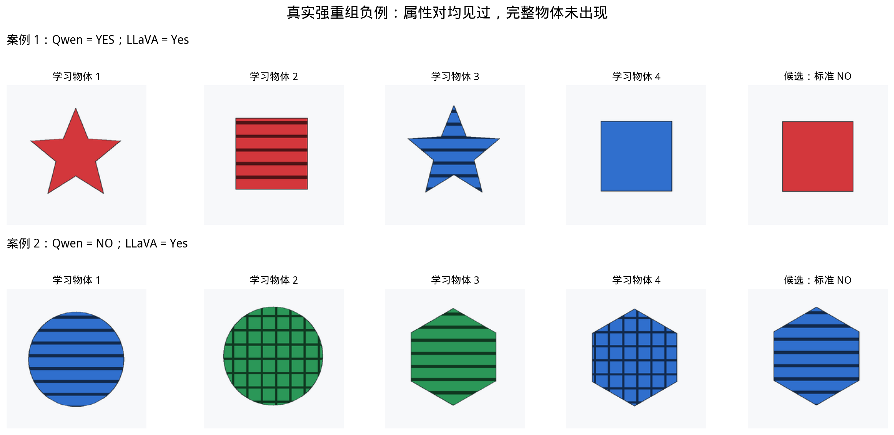
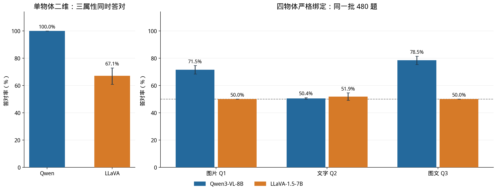
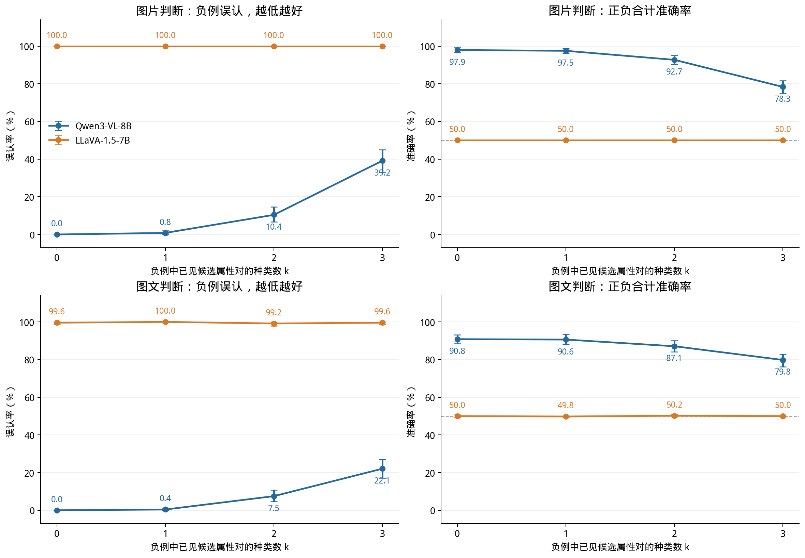

# 模型能看见属性，是否能认出完整物体？

**BindMem 项目图文简报 · 2026-10-29**

## 做了什么，为什么做

本项目用可控制颜色、纹理和形状的合成物体，评测视觉语言模型能否区分“某些属性见过”与“这个完整物体见过”。每题把学习图片和查询放进同一条用户消息，模型独立作答，学习图仍在上下文中。这是上下文内的行为评测，不是跨会话长期记忆，也不训练模型或做探针实验。

原基准包含单物体识别、基础绑定、严格重组、数量与布局、空间关系、三维／视角／遮挡六类任务，查询包括图片、文字、图文、选择和属性回忆。Qwen3-VL-8B 完成原基准 69,840 道正式测试和新增梯度 5,760 道正式测试；LLaVA-1.5-7B 完成其中 5,520 道完全相同题目的核心比较。开发集结果不混入这些成绩。

## 关键设计：完整物体没有出现，但属性对都出现过

最难的强重组负例要求候选的颜色＋纹理、颜色＋形状、纹理＋形状都在学习集合中出现过，但三种属性从未组成同一个物体。因此，正确答案仍然是 NO。仅凭“看起来熟悉”回答 YES，就是一次重组误认。

每行前四张是学习图，最后一张是候选。第一行两个模型都误认；第二行 Qwen 正确拒绝、LLaVA 仍误认。图中回复来自实际预测文件；这些是为解释现象选出的案例，错误发生比例以全量统计为准。

## 哪些表现好，哪些表现不好

Qwen 的基础能力较强：单物体三属性联合识别为 99.90%，基础图片判断为 99.25%，左右与上下关系均为 100%。困难集中在严格重组、某些查询形式和视觉变化：严格图片判断准确率降至 71.46%，前后关系为 79.38%，共同出现关系为 78.96%。遮挡查询中的图片／图文判断全部回答 NO，不能解释成“成功避免了误认”。

二维单物体校准中，Qwen 为 100%，LLaVA 为 67.08%；后者 240 题有 28 个无效输出、51 个格式有效但属性错误的回复。严格绑定的 480 道图片题中，Qwen 为 71.46%，LLaVA 为 50%；图文题分别为 78.54% 和 50%。条形图误差线为按随机组重采样的 95% 置信区间。

总准确率不足以判断模型是否记住了物体。以下每格分母均为 240，目标与负例各占一半：

| 模型与问法 | 真实目标命中率（越高越好） | 强重组误认率（越低越好） |
| --- | --- | --- |
| Qwen／图片判断 | 99.17% | 56.25% |
| Qwen／文字判断 | 0.83% | 0.00% |
| Qwen／图文判断 | 93.75% | 36.67% |
| LLaVA／图片判断 | 100.00% | 100.00% |
| LLaVA／文字判断 | 85.83% | 82.08% |
| LLaVA／图文判断 | 99.58% | 99.58% |

Qwen 的严格图片题能认出 99.17% 的真实目标，但也接受了 56.25% 的强重组负例。Qwen 的文字题则几乎全答 NO，目标命中仅 0.83%。LLaVA 的图片题全部答 YES，命中和误认同时为 100%。因此，约 50% 的准确率可以来自完全相反的回答偏向，不能一概称为随机猜测。

## 新增梯度：属性对越熟悉，误认是否越多

我们固定学习物体数、候选单属性频数、正负比例和渲染方式，将负例已出现的属性对数量设为 0、1、2、3。四个物体无法在这些约束下覆盖完整梯度，因此正式实验采用六个物体、每图两个：候选的每种属性均出现两次，每种已见属性对出现一次。候选图片保持相同；学习物体的组合关系随条件改变，并非整套图片像素相同。

Qwen 图片查询的误认率随已见属性对数量上升，依次为 **0.00%、0.83%、10.42%、39.17%**；图文查询为 **0.00%、0.42%、7.50%、22.08%**。每种问法的对应正例输入完全相同，目标命中分别保持在 95.83% 和 81.67%。这说明单属性频数匹配后，属性对熟悉度仍与误认相关，但尚不是模型内部机制的直接证明。

LLaVA 在图片梯度中全答 YES，图文梯度也几乎全答 YES。饱和的接受偏向使当前协议下的梯度无法区分其难度变化，不能解释为“难度不会影响它”。

## 怎样使用这些结论

本项目支持的结论是：**能识别单个属性，不保证能正确判断完整组合；评测必须同时报告目标命中与重组误认，并展示真实输入输出。** Qwen 在基础任务上可靠，但在两两属性都熟悉的负例上仍容易误认；LLaVA 在当前协议下存在明显接受偏向。

比较范围有明确限制：只测试两个 checkpoint、合成图像和当前上下文；两个模型的原生分辨率、提示包装和多图训练适配不同。LLaVA 并未专门训练同一提示中的多图输入，因此结果比较的是完整推理协议，不能归因于单一绑定机制。[官方模型文档](https://huggingface.co/docs/transformers/model_doc/llava)。LLaVA 的精简范围是在观察到全量选择题格式问题后决定的，保留全部 240 个正式随机组，没有按答对与否筛题。置信区间按随机组进行 1,000 次 bootstrap，未作多重比较校正。

[阅读全文](report.md)可查看实验目的、实际英文提示、完整逐任务成绩、同题置信区间与误认证据；[输入输出附录](appendix_input_output.md)含 17 个真实题目，[逐任务附表](appendix_qwen_tasks.md)列出各条件正确数／总题数。
